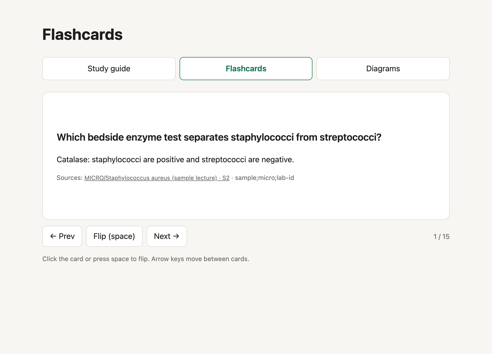
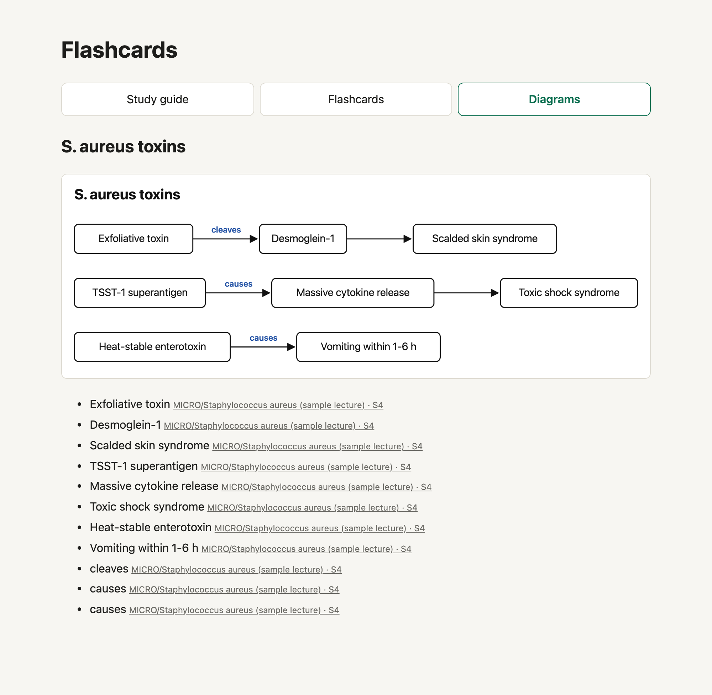
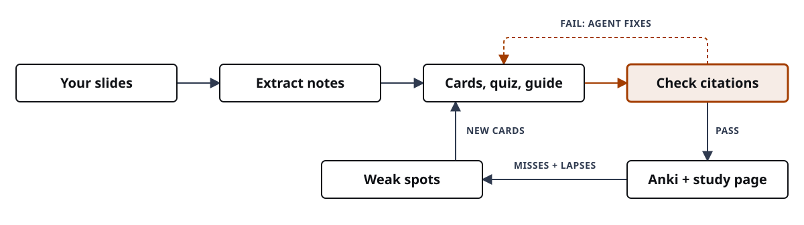
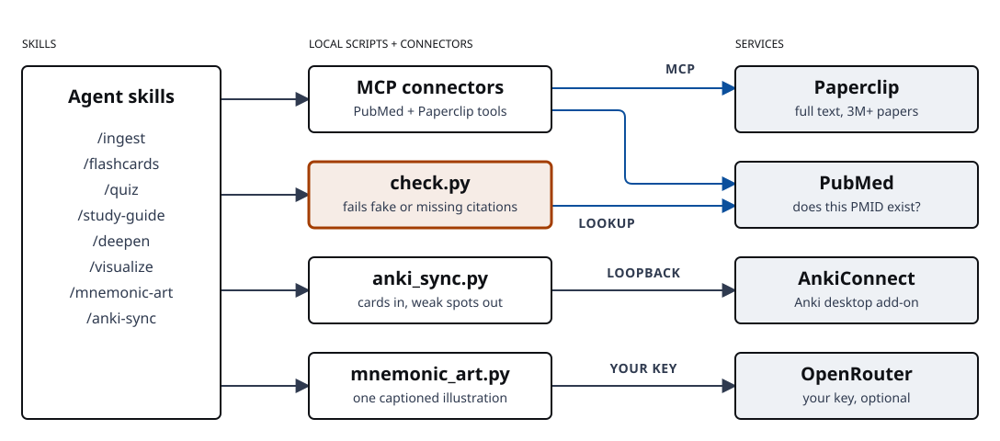

<div align="center">


# Med Student AI Study Agent

**Your own course slides in. Cited flashcards, quizzes, and study guides out.**

Every fact links to a **slide number** in your deck or a **PubMed record**, and a checker
fails the output when a citation is fake, retracted, or missing.

> **Educational demo: AI should power your learning, not replace it.** Your course materials belong to your
> institution; anything you upload to an AI tool must follow your school's AI policy.
> Read [`docs/RESPONSIBLE-USE.md`](docs/RESPONSIBLE-USE.md).

[Quick start](#quick-start) · [Requirements](docs/REQUIREMENTS.md) · [Skills](#skills) · [Ground rules](#ground-rules) · [Report an issue](https://github.com/sajor2000/med-student-ai-demo/issues)

For M1/M2 students in case-based basic-science curricula, and the instructors who teach them.
Works in **Claude Code** or **Codex**.

</div>

## What you get

| | |
|---|---|
| **Cited flashcards** | Basic and cloze Anki decks plus a flip-card web page. A slide citation opens that slide. |
| **Practice quizzes** | One USMLE-style vignette at a time. Explanations quote the slide, and misses become your next cards. |
| **Study guides** | A cited reference to check yourself against after recall, with "beyond the slides" boxes from StatPearls and PubMed. |
| **Diagrams** | A cited diagram spec, a rendered picture, and Anki Image Occlusion cards. |
| **A citation checker** | `scripts/check.py` fails fake PMIDs, retracted papers, missing slides, and uncited cards. |

<p align="center">
  
  
</p>

## The study loop

<p align="center">
  
</p>

Active recall first, reading last. Quiz misses and Anki lapses feed the next round of cards.

## Quick start

No course files needed. About 15 minutes on a fresh laptop. Full list and per-OS installs: [`docs/REQUIREMENTS.md`](docs/REQUIREMENTS.md).

**1. Install** an agent harness, `uv`, Node 24+, and `git`.

macOS (needs [Homebrew](https://brew.sh)):
```bash
brew install uv node git
curl -fsSL https://claude.ai/install.sh | bash     # Claude Code (Codex: npm i -g @openai/codex)
```
Windows (PowerShell):
```powershell
winget install astral-sh.uv OpenJS.NodeJS Git.Git
irm https://claude.ai/install.ps1 | iex           # Claude Code (Codex: npm i -g @openai/codex)
```

**2. Clone and try the sample lecture** (synthetic, safe to share):
```bash
git clone https://github.com/sajor2000/med-student-ai-demo
cd med-student-ai-demo
uv run scripts/extract.py sample/curriculum --out sample/notes
uv run scripts/check.py examples/flashcards.csv --notes sample/notes
uv run scripts/export.py examples/flashcards.csv --guide examples/study-guide.md --notes sample/notes
open examples/flashcards.html                      # macOS
```
On Windows (PowerShell), open the page with:
```powershell
start examples\flashcards.html
```

**3. Start your agent in the folder.**

<table>
<tr><th>Claude Code</th><th>Codex</th></tr>
<tr><td>

```bash
claude
```
Approve the project's MCP servers, then `/mcp` to sign in to Paperclip.
Skills are slash commands: `/ingest`, `/flashcards`, ...

</td><td>

```bash
codex mcp add paperclip --url https://paperclip.gxl.ai/mcp   # once: register for sign-in
codex mcp login paperclip                                    # once: sign in
codex
```
Codex reads `AGENTS.md`, `.agents/skills/`, and `.codex/config.toml` here. Name a skill in your prompt, for example "use the ingest skill on <case>".

</td></tr>
</table>

Other agent harnesses can follow [`AGENTS.md`](AGENTS.md) and read `.claude/skills/*/SKILL.md`; the PubMed and Paperclip setup is in `.mcp.json`.

**4. Verify.** Run the short checklist in [`docs/REQUIREMENTS.md`](docs/REQUIREMENTS.md#verify-your-setup) (`node -v`, `uv --version`, `claude mcp list`, or `/mcp` inside Codex).

## Use it on your own course

1. Check your school's AI policy for course materials (see [Ground rules](#ground-rules)).
2. Copy one case's slides and guides into `curriculum/<case-name>/`. The folder is gitignored.
3. Run the skills in this order.

## Skills

| Command | What you get |
|---|---|
| `/ingest <case>` | Notes with slide anchors, plus a map of the case's topics and cross-discipline threads |
| `/flashcards <case> ["topic"] [n]` | `output/<case>/flashcards.csv`, verified, then Anki files (`.anki.txt` basic, `.cloze.anki.txt` cloze) for deck `AI Study::<case>` and a `.html` flip-card page |
| `/quiz <case> ["topic"] [n]` | One vignette at a time. Misses are saved to `weak-spots.md` |
| `/flashcards <case>` again | New cards aimed at your weak spots. Re-importing updates cards instead of duplicating them |
| `/study-guide <case> ["topic"]` | A cited reference for **after** recall |
| `/deepen "<concept>" [case]` | A "how do we know?" explainer from StatPearls, reviews, and Paperclip full text |
| `/visualize <case> "topic"` | A cited diagram spec, a rendered diagram, and Image Occlusion cards. Needs the diagram-design plugin and Chromium |
| `/mnemonic-art <case> ["concept"]` | One captioned AI illustration as a memory hook. An aid, never a reference. Needs an OpenRouter key |
| `/vignette <case> [n]` | About 5 synthetic board-style vignettes. You type an answer first, then see 5 look-alike options. Misses become cited cards |
| `/teach-back <case> "mechanism"` | Explain a mechanism in four steps plus a what-if, get marked against the slides, then compare with a cited expert model |
| `/anki-sync <case>` | Pushes cards into Anki desktop and pulls cards you keep missing into `weak-spots.md`. Needs AnkiConnect |

These cards **supplement** a premade deck (for example AnKing): they follow *your course's* cases and faculty emphasis.

In Anki, import each file once (File > Import). Re-importing an edited deck updates cards. To put diagrams on your study page, add them to the export:

```bash
uv run scripts/export.py output/<case>/flashcards.csv --guide output/<case>/study-guide.md \
    --notes notes/<case> --diagrams output/<case>/diagrams
```

To include your AI illustrations too, add `--art output/<case>/art` to the end of that command.

The page gets a Diagrams tab (the picture plus each label with its citation) and, with `--art`, a Memory aids
tab under the heading "AI illustrations — memory aids, not references". `--deepen output/<case>/deepen` adds a Deep dives tab with your `/deepen` explainers. A finished example, with no art, is in
`examples/diagrams/` and `examples/flashcards.html`.

## How it fits together

<p align="center">
  
</p>

- **PubMed**: [`@cyanheads/pubmed-mcp-server`](https://github.com/cyanheads/pubmed-mcp-server), pinned in `.mcp.json` and `.codex/config.toml`. Optional `NCBI_API_KEY` and `NCBI_EMAIL` raise rate limits.
- **Paperclip**: hosted biomedical full-text search (3M+ papers). Sign in once.
- If PubMed is down, the skills still work from your slides and say the literature step was skipped.

Prefer open source end to end? [`docs/OPEN-RESOURCES.md`](docs/OPEN-RESOURCES.md) lists trusted free sources, open agents, local models, and "private mode".

## What the checker proves, and what it doesn't

- Course citation: `[[MICRO/Staph aureus#S3]]` is that deck, slide 3 (`#P12` Word paragraph, `#T2` Word table).
- Literature citation: `[PMID:26016486]` is a real PubMed record.

AI models invent realistic-looking PMIDs. `scripts/check.py` **catches** PMIDs that don't exist, retracted papers, slides that don't exist, cards or bullets with no citation, and malformed cloze markup. It **does not catch** a real source that doesn't say what the card claims, or a medical error.

**PASS means the sources exist.** Open 2 or 3 cited slides or papers before you study a deck. See it fail on purpose:

```bash
uv run scripts/check.py examples/hallucination-test.csv --notes sample/notes
```

## Responsible use

Full text: [`docs/RESPONSIBLE-USE.md`](docs/RESPONSIBLE-USE.md).

- **Use AI to learn, not to skip learning.** Try each question first; the agent checks you, it does not do your work.
- **Your course materials belong to your institution.** Keep them out of git and public places.
- **Follow your institution's AI policy.** Confirm it allows uploading course content before you start.
- **Never** put patient information in, or use these tools on graded work.

A 20-30 minute demo uses the fictional case in `sample/curriculum/GUIDE` (BMS 501 Case 2: Jordan Rivera). Start with [`docs/DEMO-WALKTHROUGH.md`](docs/DEMO-WALKTHROUGH.md).

## Ground rules

1. **Never put patient information (PHI) into these tools.** Slides normally have none. If a deck has real patient cases or images, leave it out.
2. **Slides stay out of git and public places.** They belong to your school. The agent sends the text it reads to your AI provider, and Paperclip searches go to Paperclip, so follow your school's AI policy. For fully local use, see "private mode" in `docs/OPEN-RESOURCES.md`. The `<name>_sources/` folder next to a study page is a copy of slide text: keep it to yourself.
3. **The course is the exam's ground truth.** When a source disagrees, the agent flags a discrepancy for you to ask faculty. It never overwrites the slide.
4. **AI pictures are memory aids.** Diagrams are cited specs you can check. `/mnemonic-art` pictures are labeled aids, each costs credits and goes to a second provider (OpenRouter).
5. **Spot-check before you study.** PASS means the sources exist, not that they're right.
6. **Study aid, not a shortcut.** Don't use it for graded work, and do the reviews yourself: the learning comes from recalling the answers.

## Repo map

```
AGENTS.md                 agent rules: citations, source ladder, privacy (single source of truth)
CLAUDE.md                 imports AGENTS.md, plus Claude Code notes
.claude/skills/           the ten skills (ingest ... anki-sync, vignette, teach-back)
.agents/skills            symlink to .claude/skills, for Codex
.mcp.json                 PubMed + Paperclip for Claude Code
.codex/config.toml        the same connectors for Codex
.claude/settings.json     pre-approves the scripts and PubMed/Paperclip tools
scripts/                  extract, check, export, occlude, anki_sync, mnemonic_art, coverage
sample/  examples/        synthetic lecture, and finished outputs built from it
docs/                     REQUIREMENTS, OPEN-RESOURCES, diagram teaching profile, images
curriculum/               YOUR files go here (gitignored)
tests/                    script tests: uv run --with pytest --with markdown --with genanki --with pillow --with playwright --with pymupdf pytest tests -q
```

What each skill is based on, and how strong that evidence is: [docs/LEARNING-SCIENCE.md](docs/LEARNING-SCIENCE.md).
