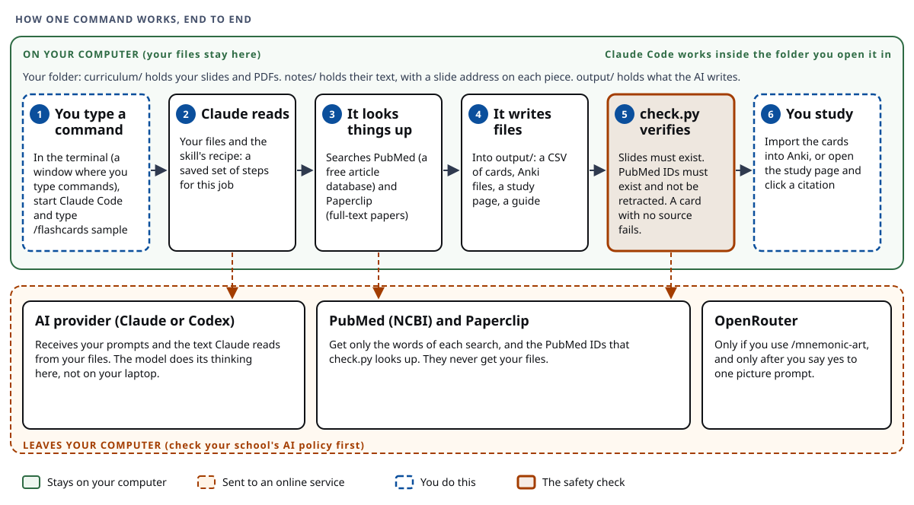
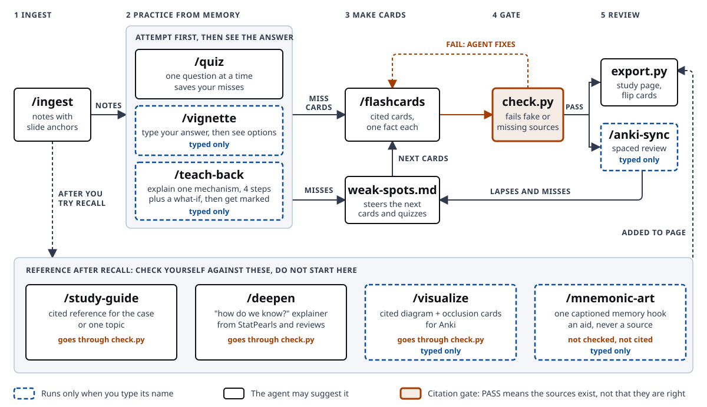

<div align="center">


# Med Student AI Study Agent

**Your own course slides in. Cited flashcards, quizzes, and study guides out.**

> **Educational demo: AI should power your learning, not replace it.** Your course materials belong to your
> institution; anything you upload to an AI tool must follow your school's AI policy.
> Read [`docs/RESPONSIBLE-USE.md`](docs/RESPONSIBLE-USE.md).

[New here?](#new-to-claude-code-start-here) · [Quick start](#quick-start) · [Requirements](docs/REQUIREMENTS.md) · [Skills](#skills) · [Skills guide](docs/SKILLS-GUIDE.md) · [Ground rules](#ground-rules) · [Report an issue](https://github.com/sajor2000/med-student-ai-demo/issues)

For M1/M2 students in case-based basic-science curricula, and the instructors who teach them.
Works in **Claude Code** or **Codex**.

</div>

## What you get

Put your lecture PDF or slides in a folder on your computer. Open an AI assistant called Claude Code, and type `/flashcards`.
You get [Anki](https://apps.ankiweb.net) flashcards (Anki is a free app that schedules your reviews) where every fact links to the
slide it came from. The same folder can also give you practice questions, a study guide, and diagrams.
A checker program fails the output when a citation is fake, retracted, or missing.

| | |
|---|---|
| **Cited flashcards** | Basic and cloze (fill-in-the-blank) Anki decks plus a flip-card web page. A slide citation opens that slide. |
| **Practice quizzes** | One USMLE-style vignette at a time. Explanations quote the slide, and misses become your next cards. |
| **Study guides** | A cited reference to check yourself against after recall, with "beyond the slides" boxes from StatPearls and PubMed. |
| **Diagrams** | A cited diagram spec, a rendered picture, and Anki Image Occlusion cards. |
| **A citation checker** | `scripts/check.py` fails fake PMIDs, retracted papers, missing slides, and uncited cards. |

<p align="center">
  
  
</p>

## New to Claude Code? Start here

You do not need to know how to code. You need to be able to open a window, type a short command, and press Enter.

**What is Claude Code?** It is an AI assistant that runs inside a **terminal** (a window where you type commands instead of clicking buttons).
It can read and write files in one **folder** on your computer, the folder you start it in. You ask it for things in plain English.

**What is a skill?** A skill is a saved recipe. You trigger it by typing a **slash command**, which is `/` plus the recipe's name, such as `/flashcards`.
This project has ten skills. Each one is a short text file in `.claude/skills/` that tells the AI exactly what steps to follow.

**What are connectors (MCP)?** They are how the AI looks things up outside your computer: **PubMed** (the free database of biomedical articles)
and **Paperclip** (a search tool for full-text papers). MCP stands for Model Context Protocol, the standard way to plug these in. You never use it directly.

**What happens to my files?** The files stay on your computer. But the AI cannot read a file without receiving its text, so the text it reads is sent to the AI company
(Anthropic for Claude Code, OpenAI for Codex). Your PubMed and Paperclip searches go to those services. Check your school's AI policy before you put course files in. See [Ground rules](#ground-rules).

**What does it cost?** The skills and scripts in this repo are free. Claude Code needs a Claude subscription (or an Anthropic API account), and Codex needs a ChatGPT plan or API key.
One skill, `/mnemonic-art`, is optional and spends credits on a second service. The full list is in [`docs/REQUIREMENTS.md`](docs/REQUIREMENTS.md).

<p align="center">
  
</p>

### Words you will see

| Word | What it means here |
|---|---|
| Terminal | The window where you type commands. On a Mac it is the Terminal app. On Windows it is PowerShell. |
| Folder | A directory on your computer. You start Claude Code *in* a folder, and it works there. |
| Command | A line you type and run with Enter, such as `git clone ...` or `uv run scripts/check.py ...`. |
| Claude Code, Codex | AI assistants that run in the terminal. Use either one. |
| Skill, slash command | A saved recipe. Type its name after `/`, for example `/quiz`. |
| Case | One week or unit of your course, kept in its own folder, for example `curriculum/case2`. Commands take the case name. |
| Notes | The text pulled out of your slides, with an address on each piece. `/ingest` makes them. |
| Citation | The source for a fact. `[[MICRO/Staph aureus#S3]]` means slide 3 of that deck. `[PMID:26016486]` means a PubMed article. |
| PubMed, PMID | PubMed is the free article database. A PMID is an article's ID number there. |
| Anki, cloze card | Anki is a free flashcard app with spaced review. A cloze card hides one word: "Staph is {{c1::catalase}}-positive". |
| MCP connector | The plug-in that lets the AI search PubMed or Paperclip. |

## Quick start

No course files needed. About 15 minutes on a fresh laptop. Full list and per-OS installs: [`docs/REQUIREMENTS.md`](docs/REQUIREMENTS.md).

**Step 0. Open a terminal.** On a Mac, press Cmd+Space, type `Terminal`, and press Enter. On Windows, open the Start menu, type `PowerShell`, and press Enter.
Type each command below into that window and press Enter. Copy and paste works.

**Step 1. Install the tools.** This puts four programs on your computer: `uv` (runs this project's scripts and installs the Python they need), Node (needed by the PubMed connector),
`git` (downloads the project), and an AI assistant.

macOS (needs [Homebrew](https://brew.sh), a Mac app installer):
```bash
brew install uv node git
curl -fsSL https://claude.ai/install.sh | bash     # Claude Code (Codex: npm i -g @openai/codex)
```
Windows (PowerShell):
```powershell
winget install astral-sh.uv OpenJS.NodeJS Git.Git
irm https://claude.ai/install.ps1 | iex           # Claude Code (Codex: npm i -g @openai/codex)
```

**Step 2. Download the project and try the sample lecture.** The sample is a made-up lecture, safe to share. The first two lines download the project and move into its folder.
The next three turn the lecture into notes, check a set of cards, and build a flashcard page.
```bash
git clone https://github.com/sajor2000/med-student-ai-demo
cd med-student-ai-demo
uv run scripts/extract.py sample/curriculum --out sample/notes
uv run scripts/check.py examples/flashcards.csv --notes sample/notes
uv run scripts/export.py examples/flashcards.csv --guide examples/study-guide.md --notes sample/notes
open examples/flashcards.html                      # macOS
```
The last line opens the page in your browser. On Windows (PowerShell), open the page with:
```powershell
start examples\flashcards.html
```
`check.py` should print `PASS`. Click a citation on the page to open the slide it points to.

**Step 3 (recommended). Check your setup.** This command looks for `uv`, Python, Node, a network connection, and the optional features, and tells you what to fix:
```bash
uv run scripts/doctor.py
```

**Step 4. Start the AI assistant in the project folder.** It is now ready to take slash commands.

<table>
<tr><th>Claude Code</th><th>Codex</th></tr>
<tr><td>

```bash
claude
```
Approve the project's connectors (PubMed, Paperclip) when asked. Then type `/mcp` and sign in to Paperclip.
Now try a skill: `/ingest`, `/flashcards`, ...

</td><td>

```bash
codex mcp add paperclip --url https://paperclip.gxl.ai/mcp   # once: register for sign-in
codex mcp login paperclip                                    # once: sign in
codex
```
Codex reads `AGENTS.md`, `.agents/skills/`, and `.codex/config.toml` here. Name a skill in your prompt, for example "use the ingest skill on <case>".

</td></tr>
</table>

Other agent harnesses can follow [`AGENTS.md`](AGENTS.md) and read `.claude/skills/*/SKILL.md`; the PubMed and Paperclip setup is in `.mcp.json`.

**Step 5. Verify.** Run the short checklist in [`docs/REQUIREMENTS.md`](docs/REQUIREMENTS.md#verify-your-setup) (`node -v`, `uv --version`, `claude mcp list`, or `/mcp` inside Codex).

Want to watch the real commands run on the sample case? [`docs/SKILLS-GUIDE.md`](docs/SKILLS-GUIDE.md) shows each one, and [`docs/DEMO-WALKTHROUGH.md`](docs/DEMO-WALKTHROUGH.md) is a 25-minute script with screenshots.

## Use it on your own course

1. Check your school's AI policy for course materials (see [Ground rules](#ground-rules)).
2. Make a folder for one case inside `curriculum/`, named with lowercase letters, digits, and hyphens, such as `curriculum/case2`. Copy that case's slides, guides, and lecture transcripts (`.vtt`, `.srt`) into it. `curriculum/` is ignored by git, so these files are never uploaded by accident.
3. Type `/ingest case2` in your assistant, then follow the skill map and the table below.

## The study loop

<p align="center">
  
</p>

Active recall first, reading last. Quiz misses and Anki lapses feed the next round of cards.

## Skills

Ten skills, each with its own picture, steps, timing, and common problems in the [**Skills guide**](docs/SKILLS-GUIDE.md).

<p align="center">
  
</p>

Dashed blue boxes run only when you type their name. Everything else the agent may suggest. The commands, in order:

| Command | What you get | How it works |
|---|---|---|
| `/ingest <case>` | Notes with slide anchors, plus a map of the case's topics and cross-discipline threads | [guide](docs/SKILLS-GUIDE.md#ingest) |
| `/flashcards <case> ["topic"] [n]` | `output/<case>/flashcards.csv`, verified, then Anki files (`.anki.txt` basic, `.cloze.anki.txt` cloze) for deck `AI Study::<case>` and a `.html` flip-card page | [guide](docs/SKILLS-GUIDE.md#flashcards) |
| `/quiz <case> ["topic"] [n]` | One vignette at a time. Misses are saved to `weak-spots.md` | [guide](docs/SKILLS-GUIDE.md#quiz) |
| `/flashcards <case>` again | New cards aimed at your weak spots. Re-importing updates cards instead of duplicating them | [guide](docs/SKILLS-GUIDE.md#flashcards) |
| `/study-guide <case> ["topic"]` | A cited reference for **after** recall | [guide](docs/SKILLS-GUIDE.md#study-guide) |
| `/deepen "<concept>" [case]` | A "how do we know?" explainer from StatPearls, reviews, and Paperclip full text | [guide](docs/SKILLS-GUIDE.md#deepen) |
| `/visualize <case> "topic"` | A cited diagram spec, a rendered diagram, and Image Occlusion cards. Needs the diagram-design plugin and Chromium | [guide](docs/SKILLS-GUIDE.md#visualize) |
| `/mnemonic-art <case> ["concept"]` | One captioned AI illustration as a memory hook. An aid, never a reference. Needs an OpenRouter key | [guide](docs/SKILLS-GUIDE.md#mnemonic-art) |
| `/vignette <case> [n]` | About 5 synthetic board-style vignettes. You type an answer first, then see 5 look-alike options. Misses become cited cards | [guide](docs/SKILLS-GUIDE.md#vignette) |
| `/teach-back <case> "mechanism"` | Explain a mechanism in four steps plus a what-if, get marked against the slides, then compare with a cited expert model | [guide](docs/SKILLS-GUIDE.md#teach-back) |
| `/anki-sync <case>` | Pushes cards into Anki desktop and pulls cards you keep missing into `weak-spots.md`. Needs AnkiConnect | [guide](docs/SKILLS-GUIDE.md#anki-sync) |

These cards **supplement** a premade deck (for example AnKing): they follow *your course's* cases and faculty emphasis.

In Anki, import each file once (File > Import). Re-importing an edited deck updates cards. To put diagrams on your study page, add them to the export:

```bash
uv run scripts/export.py output/<case>/flashcards.csv --guide output/<case>/study-guide.md \
    --notes notes/<case> --diagrams output/<case>/diagrams
```

To include your AI illustrations too, add `--art output/<case>/art` to the end of that command.

The page gets a Diagrams tab (the picture plus each label with its citation) and, with `--art`, a Memory aids
tab under the heading "AI illustrations — memory aids, not references". `--deepen output/<case>/deepen` adds a Deep dives tab with your `/deepen` explainers. A finished example, with no art, is in
`examples/diagrams/` and `examples/flashcards.html`.

## Which skill when

`<case>` is your folder name. Add a quoted topic to narrow any command.

| You want to... | Type |
|---|---|
| Start a new case week | `/ingest <case>`, then `/quiz <case>`, then `/flashcards <case>` |
| Use a lecture transcript | Put the `.vtt` or `.srt` in the case folder, `/ingest <case>`, then `/flashcards <case> "topic"` |
| Prepare the night before an exam | `/quiz <case> 10`, then `/flashcards <case>` (it targets your misses), then `/study-guide <case>` to check yourself |
| Check you really understand a mechanism | `/teach-back <case> "mechanism"` |
| Fix a weak topic | `/quiz <case> "topic"`, then `/flashcards <case> "topic"`, then `/deepen "concept" <case>` if the slides leave you asking why |
| Build a diagram to memorize | `/visualize <case> "topic"`, then `/anki-sync <case>` for Image Occlusion cards |
| Add a memory hook | `/mnemonic-art <case> "concept"`. It is an aid, never a source |
| Practice harder, board style | `/vignette <case> 5`. You type an answer before you see any options |
| Review daily in Anki | `/anki-sync <case>`. Review in Anki, and cards you keep missing come back as weak spots |

Try to recall before you read. Use `/study-guide` and `/deepen` as the answer key afterward, not as a first read.

## What the checker proves, and what it doesn't

- Course citation: `[[MICRO/Staph aureus#S3]]` is that deck, slide 3 (a PDF page is `#S2` too; Word files use `#P12` paragraph and `#T2` table).
- Literature citation: `[PMID:26016486]` is a real PubMed record.

AI models invent realistic-looking PMIDs. `scripts/check.py` **catches** PMIDs that don't exist, retracted papers, slides that don't exist, cards or bullets with no citation, and malformed cloze markup. It **does not catch** a real source that doesn't say what the card claims, or a medical error.

**PASS means the sources exist.** Open 2 or 3 cited slides or papers before you study a deck. See it fail on purpose:

```bash
uv run scripts/check.py examples/hallucination-test.csv --notes sample/notes
```

## Responsible use

Full text: [`docs/RESPONSIBLE-USE.md`](docs/RESPONSIBLE-USE.md).

- **Use AI to learn, not to skip learning.** Try each question first; the agent checks you, it does not do your work.
- **Your course materials belong to your institution.** Keep them out of git and public places.
- **Follow your institution's AI policy.** Confirm it allows uploading course content before you start.
- **Never** put patient information in, or use these tools on graded work.

A 20-30 minute demo uses the fictional case in `sample/curriculum/GUIDE` (BMS 501 Case 2: Jordan Rivera), a fictional M1 class PDF. Start with [`docs/DEMO-WALKTHROUGH.md`](docs/DEMO-WALKTHROUGH.md).

## Ground rules

1. **Never put patient information (PHI) into these tools.** Slides normally have none. If a deck has real patient cases or images, leave it out.
2. **Slides stay out of git and public places.** They belong to your school. The agent sends the text it reads to your AI provider, and Paperclip searches go to Paperclip, so follow your school's AI policy. For fully local use, see "private mode" in `docs/OPEN-RESOURCES.md`. The `<name>_sources/` folder next to a study page is a copy of slide text: keep it to yourself.
3. **The course is the exam's ground truth.** When a source disagrees, the agent flags a discrepancy for you to ask faculty. It never overwrites the slide.
4. **AI pictures are memory aids.** Diagrams are cited specs you can check. `/mnemonic-art` pictures are labeled aids, each costs credits and goes to a second provider (OpenRouter).
5. **Spot-check before you study.** PASS means the sources exist, not that they're right.
6. **Study aid, not a shortcut.** Don't use it for graded work, and do the reviews yourself: the learning comes from recalling the answers.

## For developers and contributors

Students can stop reading here. The rest is for people who change the code or run it for a class.

### How it fits together

<p align="center">
  
</p>

- **PubMed**: [`@cyanheads/pubmed-mcp-server`](https://github.com/cyanheads/pubmed-mcp-server), pinned in `.mcp.json` and `.codex/config.toml`. Optional `NCBI_API_KEY` and `NCBI_EMAIL` raise rate limits.
- **Paperclip**: hosted biomedical full-text search (3M+ papers). Sign in once.
- If PubMed is down, the skills still work from your slides and say the literature step was skipped.

Prefer open source end to end? [`docs/OPEN-RESOURCES.md`](docs/OPEN-RESOURCES.md) lists trusted free sources, open agents, local models, and "private mode".

### Repo map

```
AGENTS.md                 agent rules: citations, source ladder, privacy (single source of truth)
CLAUDE.md                 imports AGENTS.md, plus Claude Code notes
.claude/skills/           the ten skills (ingest ... anki-sync, vignette, teach-back)
.agents/skills            symlink to .claude/skills, for Codex
.mcp.json                 PubMed + Paperclip for Claude Code
.codex/config.toml        the same connectors for Codex
.claude/settings.json     pre-approves the scripts and PubMed/Paperclip tools
scripts/                  extract, check, export, occlude, anki_sync, mnemonic_art, coverage, doctor,
                          make_case_guide (builds the sample PDF), make_sample, pubmed-mcp.sh
sample/  examples/        synthetic lecture, and finished outputs built from it
docs/                     SKILLS-GUIDE, DEMO-WALKTHROUGH, RESPONSIBLE-USE, LEARNING-SCIENCE, FOR-EDUCATORS, REQUIREMENTS,
                          OPEN-RESOURCES, case-audit, diagram teaching profile, sample-case/ (Word case guide), img/
curriculum/               YOUR files go here (gitignored)
tests/                    script tests: uv run --with pytest --with markdown --with genanki --with pillow --with playwright --with pymupdf pytest tests -q
```

What each skill is based on, and how strong that evidence is: [docs/LEARNING-SCIENCE.md](docs/LEARNING-SCIENCE.md).

### Links

[For educators](docs/FOR-EDUCATORS.md) · [Contributing](CONTRIBUTING.md) · [Code of conduct](CODE_OF_CONDUCT.md) · [Security](SECURITY.md) · [Changelog](CHANGELOG.md) · [Notices](NOTICE.md)

## License

**Free for noncommercial use; not for sale.** The code is under the
[PolyForm Noncommercial License 1.0.0](LICENSE) and the fictional `sample/`, `examples/`, and `docs/sample-case/` content is under
CC BY-NC-SA 4.0 ([`LICENSE-CONTENT`](LICENSE-CONTENT)). You may use, change, and share it for personal study, and
schools, universities, public research bodies, and other noncommercial organizations may use it for teaching and
research. The license text decides the exact scope. Selling it or building it into a paid product or service needs a separate written license: open an issue
titled "Commercial license". These are source-available, noncommercial licenses, not OSI open source.

Your own course materials are not covered: they belong to your institution. See [`NOTICE.md`](NOTICE.md).
