# Live demo walkthrough: one fictional case, 25 minutes

> **Educational demo.** AI powers your learning; it does not replace it.
> Course materials belong to your institution: anything you upload must follow your institution's AI policy.
> Read the full [Responsible use](RESPONSIBLE-USE.md) page first. The patient, school, and faculty in this demo are invented.

This script is written for a presenter, and a student can follow it alone. It uses the fictional
case guide **BMS 501 Self-Study Guide 02, Jordan Rivera** (a 19-year-old wrestler with a CA-MRSA forearm
abscess) plus a short *S. aureus* lecture deck. Both live in `sample/curriculum/`. The case guide is a fictional M1 class PDF, a handout of the kind a school hands out as a PDF (built by `scripts/make_case_guide.py`; the editable Word file is in `docs/sample-case/`). Nothing here is real course material.

**Total time:** 25 minutes plus 5 of buffer (a 20-minute version is marked below).

Every screenshot below comes from a timed dress rehearsal on a fresh clone (Claude Code headless, PubMed connector, Node 24 or newer).
The times are what the machine took, not what you will say; talk over the waiting.

| Step | Measured |
|---|---|
| `uv run scripts/doctor.py` | 2 s |
| `/ingest sample` | 88 s |
| `/study-guide sample` | 3 to 4 min (196 s and 243 s on two runs) |
| `check.py` on the guide, then on the cards | under 1 s each (PubMed lookups included) |
| `/flashcards sample 14` | 97 to 152 s on two clean runs, then `export.py` in under 1 s |
| `/study-guide sample "MRSA resistance and treatment"` | about 4 to 4.5 min on 3 runs; 1 of 3 stopped once and recovered, all 3 guides `PASS` |
| `/flashcards sample "MRSA resistance and treatment" 10` | about 2.5 min on 3 runs, no stops, all `PASS` (10 cards) |
| `/quiz sample "MRSA resistance and treatment" 1`, question and explanation | under 2 min on 3 runs, no stops |
| `anki_sync.py` push into Anki desktop | about 4 s for 16 cards |
| `/quiz sample 3`, first question | 33 s |
| `/vignette sample 2`, first question | 87 s, then 7 to 40 s per turn |
| Asking the discrepancy question | 32 s |

The screenshots come from the full-case rehearsal (`/study-guide sample`, `/flashcards sample 14`). The live run of show
below scopes Acts 3 to 5 to MRSA resistance, so your guide is shorter, you get about 10 cards, and the topics differ
from the pictures. The commands, file names, and check output look the same.

Paperclip (the second search connector) needs a browser sign-in and was not used in the rehearsal; everything here ran on PubMed alone, which is the documented fallback.

## Before you start (5 minutes, the day before)

1. Clone the repo, then follow the README install (`uv`, Claude Code, the project MCP servers).
2. Stage the sample as your "course" (the skills read from the gitignored `curriculum/` folder):
   ```bash
   if [ -e curriculum/sample ]; then echo "curriculum/sample already exists: move it away first"; else mkdir -p curriculum && cp -R sample/curriculum curriculum/sample; fi
   ```
   If it says `already exists`, stop and rename or remove that folder yourself, so nothing but the fictional sample is ingested.
3. Open a terminal in the repo and start `claude`. Approve the project MCP servers when asked.
4. Open `examples/case2/flashcards.html` in a browser tab now. It is your fallback (see the last section).
5. Close anything with real patient or course data. Use a clean screen share.
6. Open Anki desktop with the AnkiConnect add-on (code `2055492159`). The Anki line in `doctor.py` should be green.
7. Start from a clean slate, so the counts on screen match the script: move any earlier `output/sample/` folder out of
   the repo, and in Anki delete the deck `AI Study::sample` if a rehearsal created it.

**Check you are ready:** `uv run scripts/doctor.py` ends with every line green (the Anki, Playwright, and OpenRouter lines are optional),
and `uv run scripts/check.py examples/case2/study-guide.md --notes sample/notes` prints `PASS`.

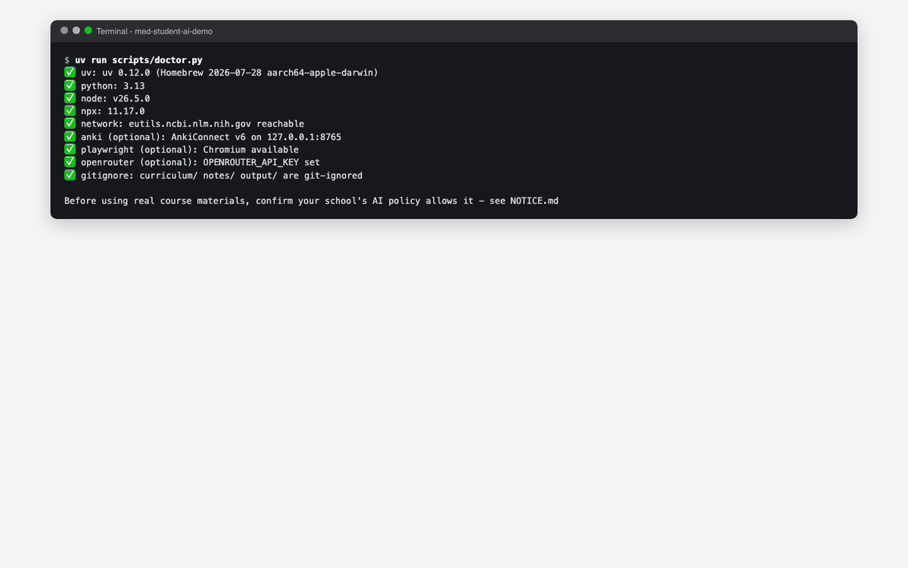


## Run of show

| Time | Act | You say / do |
|---|---|---|
| 0-3 | Why, and responsible use | Slide-free talk, then show `docs/RESPONSIBLE-USE.md` |
| 3-8 | `/ingest sample` | Turn a case guide and a deck into citable notes |
| 8-15 | `/study-guide sample "MRSA resistance and treatment"` | Build a cited guide, then check it live |
| 15-21 | `/flashcards sample "MRSA resistance and treatment" 10` + export | Open the page, click a citation |
| 21-26 | `/quiz sample "MRSA resistance and treatment" 3` | Attempt first, then explain |
| 26-30 | Live Anki sync, your own course | Push the cards into Anki, then hand off |

### Act 1 (0-3 min): why, and what responsible use means

- Say: "AI is good at drafting and quizzing. It is bad at knowing when it is wrong. This tool is built around that."
- Point at: the three rules in [RESPONSIBLE-USE.md](RESPONSIBLE-USE.md) (attempt first, open the sources, your school owns the materials).
- Point at: the repo's citation rule in `CLAUDE.md`: every fact cites a slide or a PubMed record, or is marked `[source needed]`.
- Show: the case guide's "Course Director Notes" box, which carries the same reminder about school AI policy.
- Show the handout itself as the students would get it: a PDF with a cover page and tables of lab results.

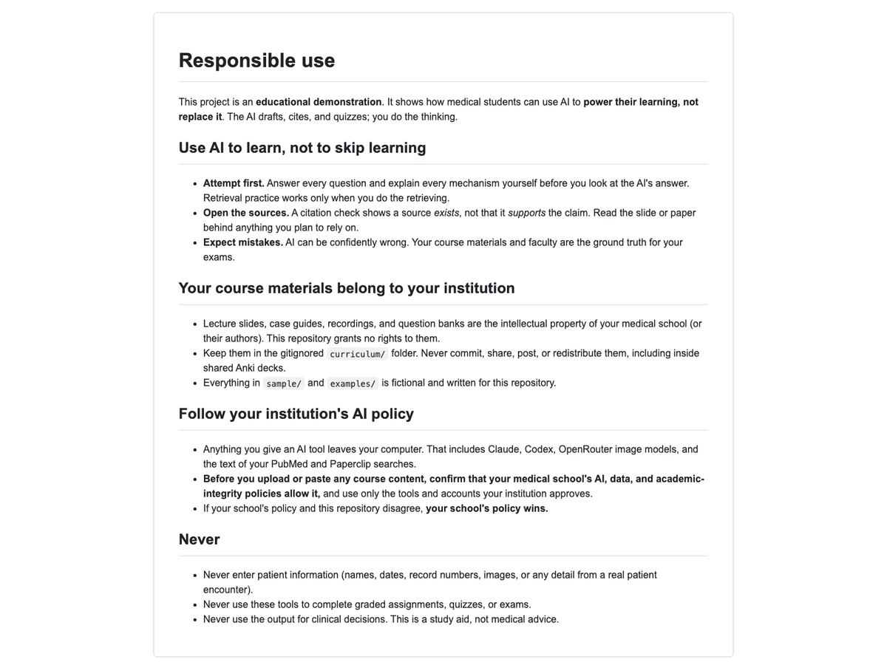

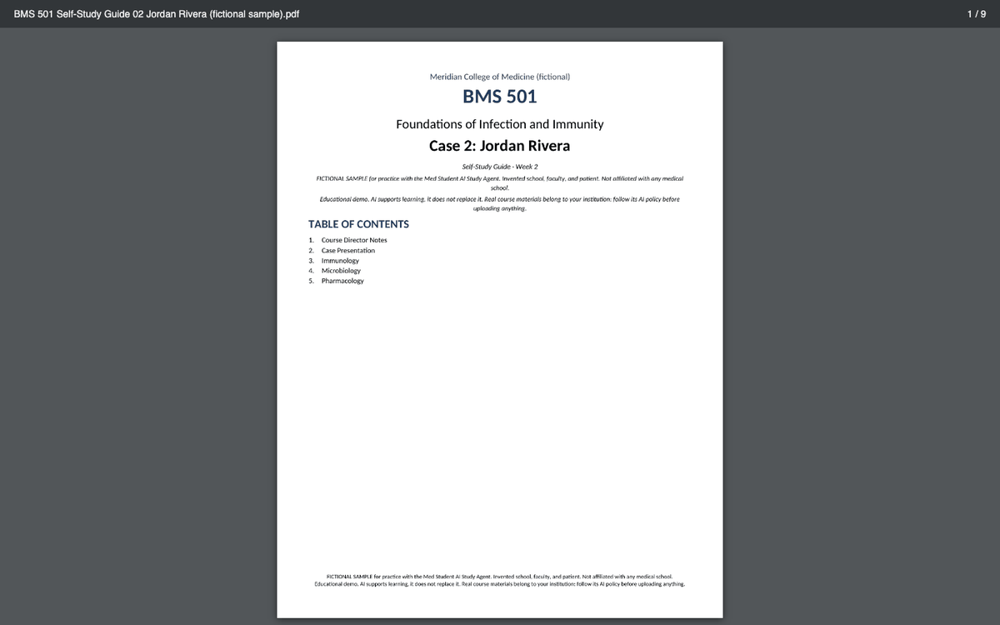

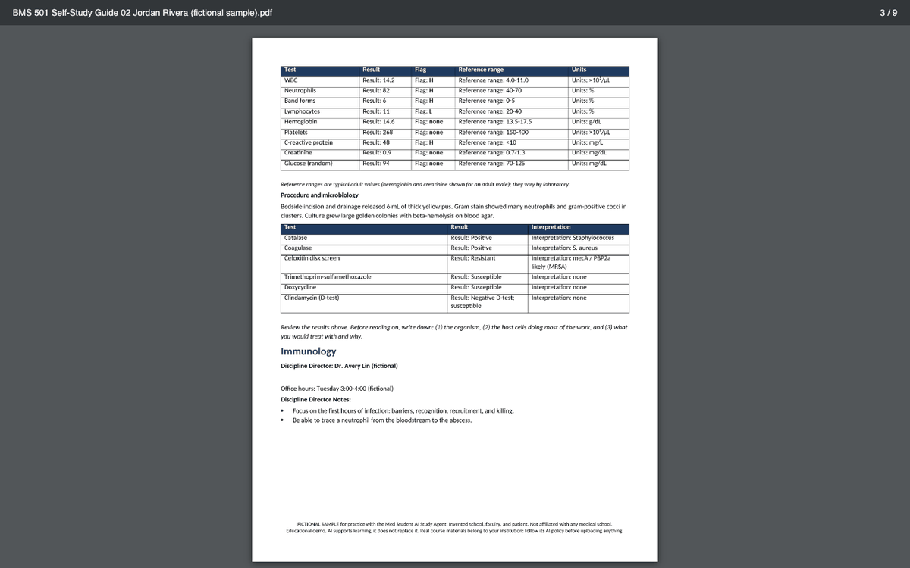


### Act 2 (3-8 min): ingest

Type in Claude Code:

```
/ingest sample
```

**Expected:** a table with three sources (the GUIDE case-guide PDF with 9 pages, the MICRO deck with 6 slides, and the PHYS renal clearance handout with 4),
the case's learning objectives quoted with citations, and 3-5 cross-discipline threads such as
protein A (micro) to blocked opsonization (immuno) to abscess to PBP2a/MRSA (pharm).

**Point at:** the citation tags. `[[GUIDE/...#S4]]` means page 4 of the guide PDF, `[[MICRO/...#S3]]` means slide 3.
Open `notes/sample/GUIDE/` and show the `## [S#]` page headings in the Markdown, so the audience sees that a citation is an address.

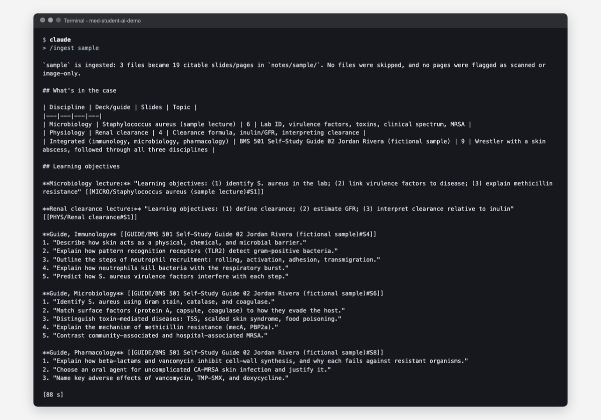


### Act 3 (8-15 min): study guide with a live citation check

```
/study-guide sample "MRSA resistance and treatment"
```

**Why this topic:** the live steps stay on resistance (mecA, PBP2a), drug choice, and drainage. The toxin chapters
(superantigen, enterotoxin, leukocidin) tripped the model's safety filter in rehearsal, so show those from the committed
`examples/case2/` files instead of generating them live. See "If the agent stops mid-answer".

**Expected:** `output/sample/study-guide.md` with objectives, a one-page summary, a mechanism chain
(exposure, recognition, recruitment, evasion, killing, lab identity, treatment), a "Beyond the slides" section with
PubMed IDs, and recall questions. The agent then runs the citation check itself.

Run the check on screen, whether or not the agent already did:

```bash
uv run scripts/check.py output/sample/study-guide.md --notes notes/sample
```

**Expected output:** a list of PubMed titles, then `PASS: every citation resolves and every fact line is cited`.

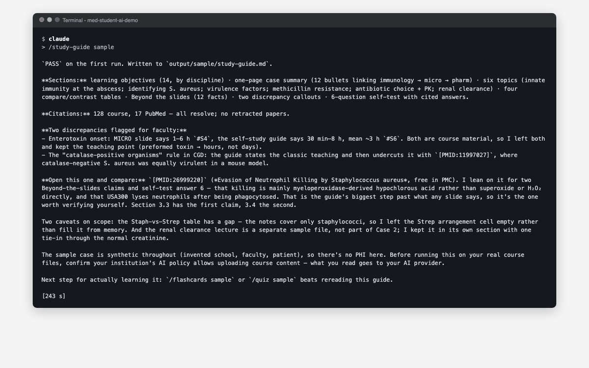

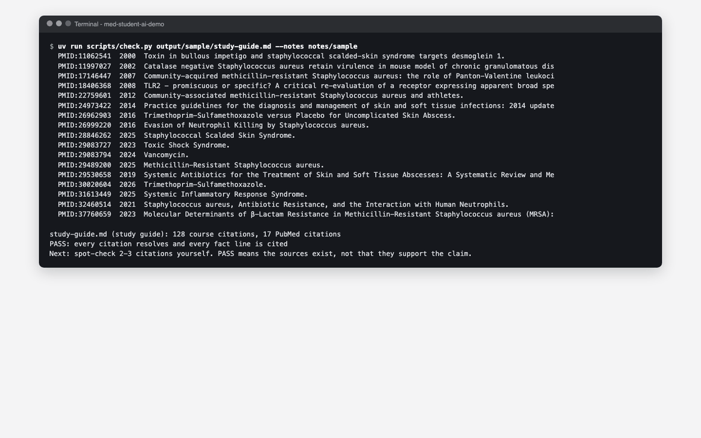


**The key teaching moment (do not skip):** `PASS` proves a source *exists*, not that it *supports* the claim.
Open one citation together. Suggested: the TMP-SMX line, `[PMID:26962903]`. Read the abstract and find
"80.5% vs 73.6%". Then ask the room: "What did the check not catch?" (Answer: whether the claim matches the paper.)

Optional beat: show `examples/case2/study-guide.md`, which has a **Discrepancies** section. The lecture says
enterotoxin vomiting starts 1-6 h after eating, and the case guide says 30 min-8 h. Real decks disagree; the agent should say so. Show it from the committed file (it is toxin material, so asking live can trip the safety filter).
If you have time and want it live, ask in the same session:
`When does vomiting start in staphylococcal food poisoning? Use the sample notes.` The agent answers with both windows,
cites both, and adds a `> ⚠️ Discrepancy:` callout instead of silently picking one.

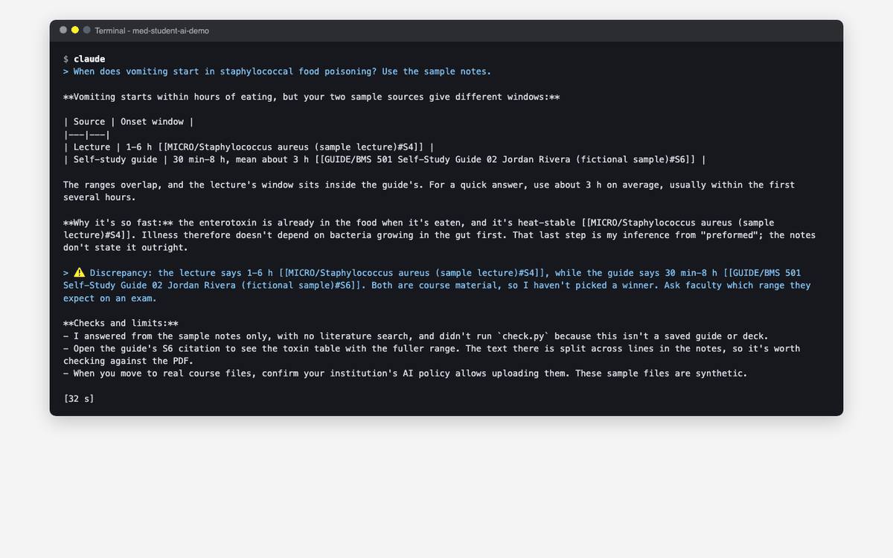

Then show that the check is real. A deliberately broken file fails, with the reason:

```bash
uv run scripts/check.py examples/hallucination-test.csv --notes sample/notes
```

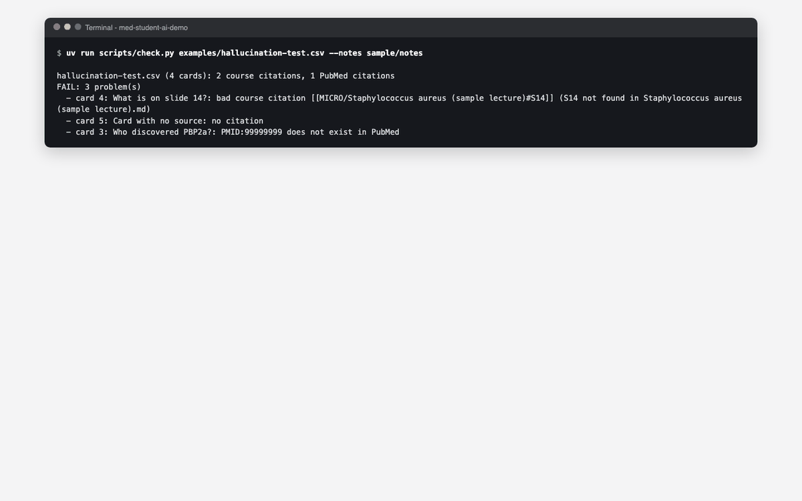


### Act 4 (15-21 min): flashcards, export, click a citation

```
/flashcards sample "MRSA resistance and treatment" 10
```

**Expected:** `output/sample/flashcards.csv` with about 10 cards (basic and cloze), each with a source. Then:

```bash
uv run scripts/check.py output/sample/flashcards.csv --notes notes/sample
uv run scripts/export.py output/sample/flashcards.csv --notes notes/sample --guide output/sample/study-guide.md
open output/sample/flashcards.html          # macOS; use xdg-open on Linux, start on Windows
```

**Expected:** `PASS`, then a page with a **Study guide** tab and flip cards.

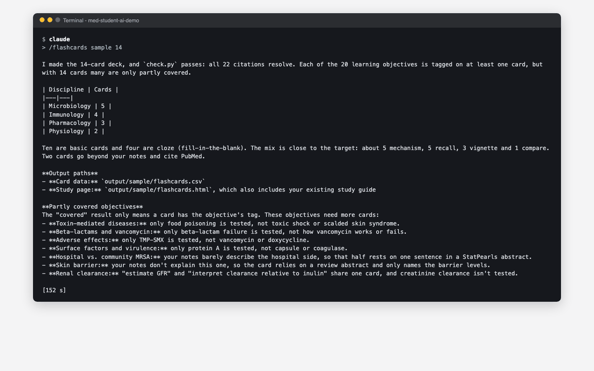

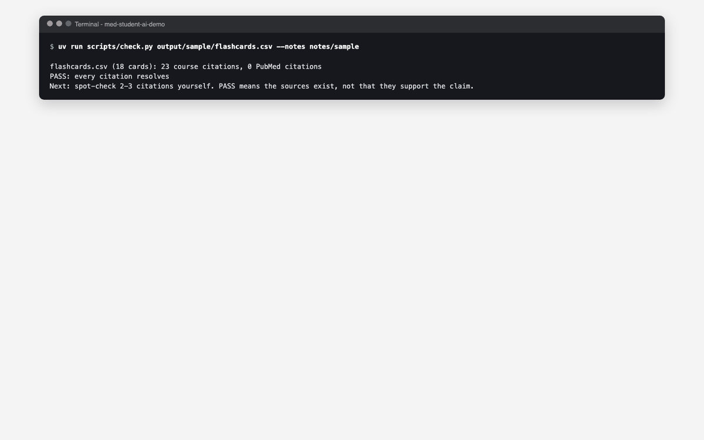

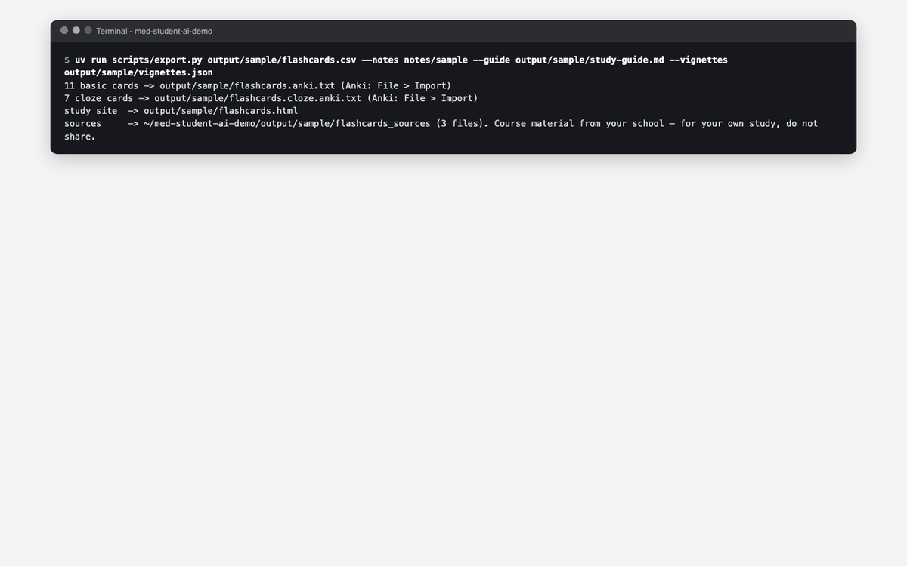


**Point at:** click a card, flip it, then click a `[[GUIDE/...#S4]]` citation. The exact page opens.
Say: "This is how you verify an AI-written card in 5 seconds." Then show one `{{c1::...}}` cloze card.

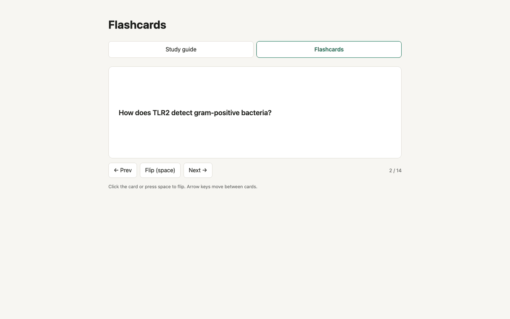

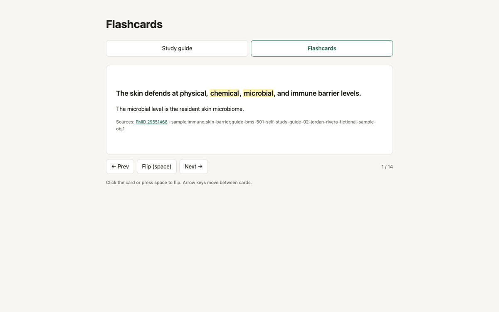

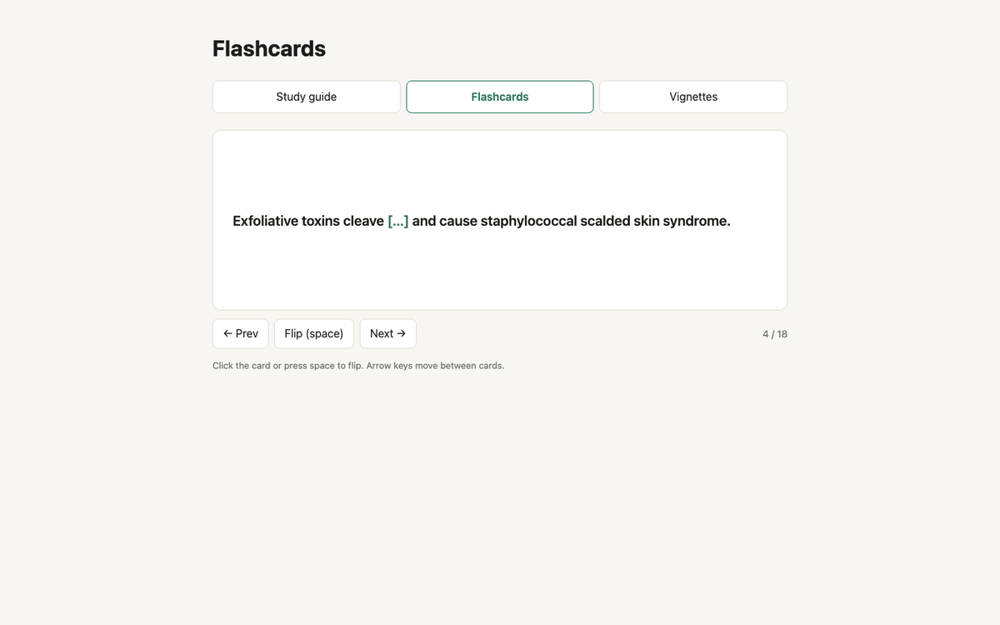

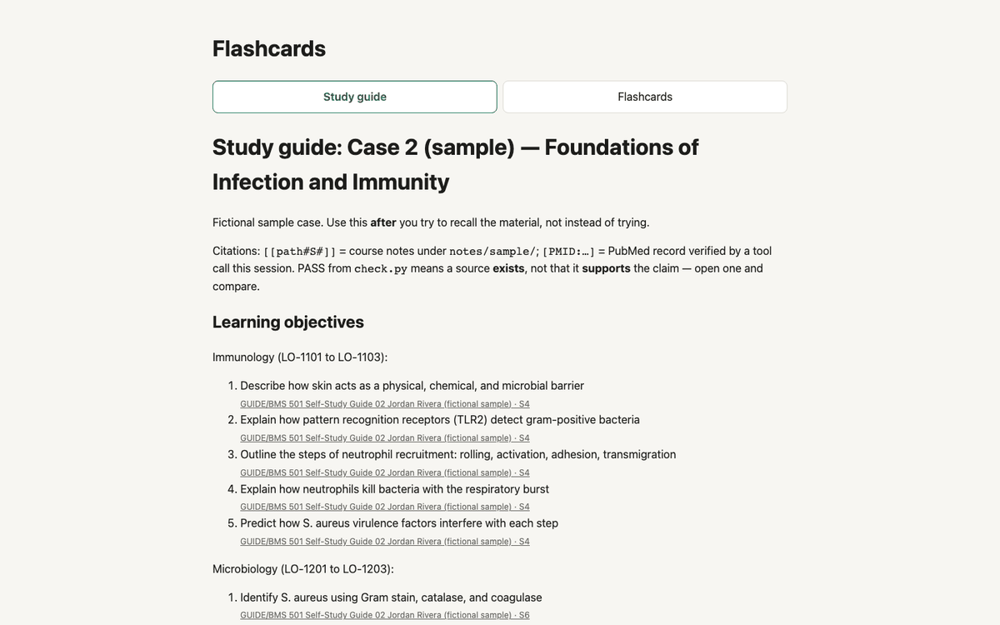

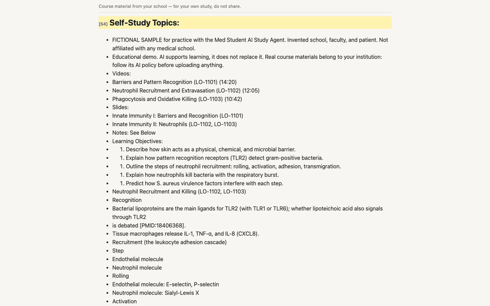


*20-minute version: skip generating live. Open `examples/case2/flashcards.html` and do only the click-a-citation beat.*

### Act 5 (21-26 min): quiz, attempt first

```
/quiz sample "MRSA resistance and treatment" 3
```

**Expected:** one vignette at a time, no answers shown. **Rule for the presenter:** ask a volunteer to answer
out loud *before* you type a letter. The agent then explains with a quoted line and a citation, and saves misses to
`output/sample/weak-spots.md` for the next `/flashcards` run.

Say: "Attempt first is the whole point. If you ask for the answer, you learn nothing."

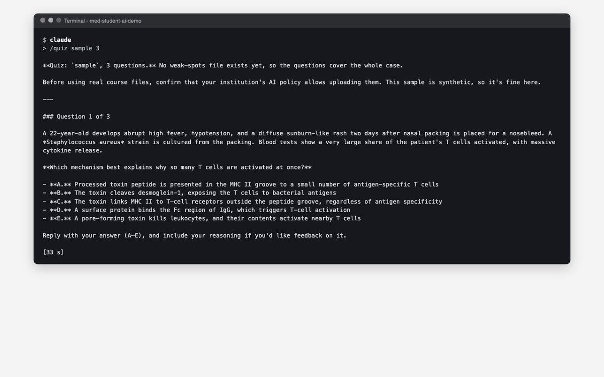


### Act 6 (26-30 min): Anki, and your own course

- **Live Anki sync.** With Anki desktop open (AnkiConnect installed), push the verified cards straight in:
  ```bash
  uv run scripts/anki_sync.py --case sample --csv output/sample/flashcards.csv
  ```
  **Expected** on a clean slate (setup step 7): one line like `added 10, updated 0, adopted 0, skipped 0, weak spots 0`
  in a few seconds (16 cards took 4 s in rehearsal). The numbers are the real counts, so they follow your card count
  and whatever the deck already holds.
  Switch to Anki: the deck `AI Study::sample` holds the basic and cloze cards, each with its source citation on the back.
  Run the same line again: `added` drops to 0 and `updated` equals the card count. Re-syncing updates cards, it never duplicates them, and it touches
  only notes tagged `msad` in `AI Study::<case>`, never the student's own or premade decks.
- Say: "After a week of reviews, the cards you lapse 3 or more times come back into `weak-spots.md`, and the next
  `/flashcards` run targets them." (`/anki-sync sample` does the same sync and explains the result in plain words.)
- **If Anki will not connect** (`exit 2`, "not reachable"): use **File, Import** with `output/sample/flashcards.anki.txt`,
  then again with `flashcards.cloze.anki.txt`. Cards land in the same deck.
- Optional extras: `/visualize` (diagrams), `/vignette`, `/teach-back`.
  Mention each in one line. `/vignette` is the safest to show: you write an answer before any options appear, and a miss becomes a cited cloze card.
  After it, re-run the export with `--vignettes output/sample/vignettes.json` added, and the study page gets a **Vignettes** tab.

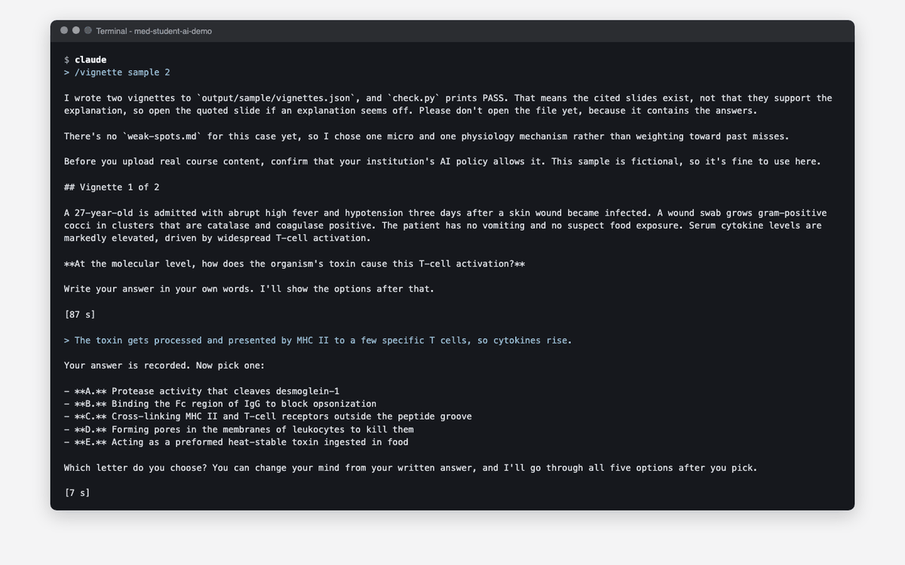

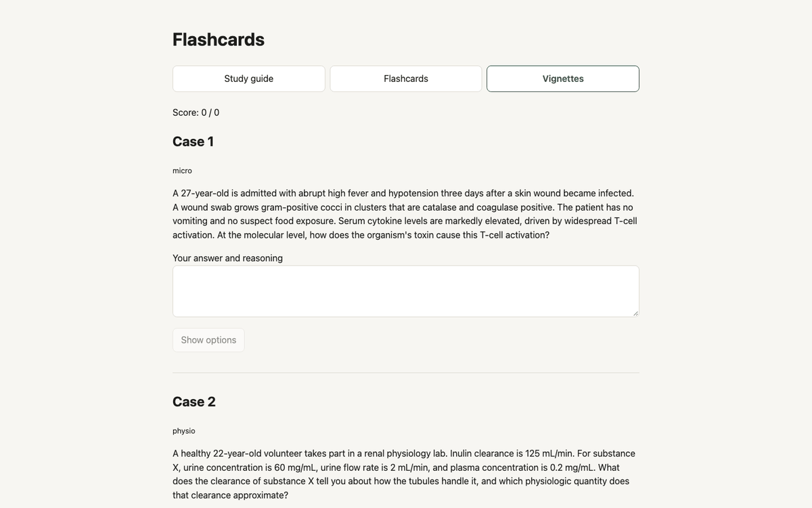

- Close with the section below.

## If the agent stops mid-answer

Toxin chapters (the superantigen, enterotoxin, and leukocidin material in the *S. aureus* lecture) can trip the model's
safety filter. In rehearsal it happened three times: once in `/study-guide`, once in a `/quiz` explanation,
and once at the end of `/teach-back`. The `/study-guide` retry passed. The agent says so plainly
("stopped by a safety classifier", "I'll stop that explanation"). Do not argue with it:

1. Run the same command once more. A file the agent wrote before the stop still passes `check.py`.
2. If it stops twice, say so, and open the committed `examples/case2/` files below. Showing a failure and the fallback is a fine demo.
3. Keep the live steps on a non-toxin topic, as the run of show does (`"MRSA resistance and treatment"`), or `"renal clearance"`.
4. Skip `/teach-back` on toxin topics live: it stopped in every rehearsal run.

## If the network fails

The agent steps and the PubMed lookups need the network. Everything you need to finish is already committed:

1. Open `examples/case2/flashcards.html` in a browser (`open examples/case2/flashcards.html`). It works offline.
2. Walk the same beats: the **Study guide** tab, flip a card, click a citation to open the source page.
3. Show the cited guide at `examples/case2/study-guide.md` and the card list at `examples/case2/flashcards.csv`.
4. Say what you would have run: `/ingest`, `/study-guide`, `/flashcards`, and the `check.py` line. Be honest that `check.py` needs the network.
5. Do the quiz from the committed notes by hand: read the questions in `sample/notes/GUIDE/` (Immunology, Microbiology, Pharmacology), let the room answer, then read the answer lines.

## Use this on your own course

1. Put your own files in the gitignored `curriculum/<case>/` folder, one folder per case or week.
   **First confirm your school's AI policy allows it.** Do not upload exams, question banks, or anything you may not share.
2. Run `/ingest <case>`, then `/study-guide <case>`, `/flashcards <case>`, and `/quiz <case>` in that order.
3. Try to recall before you read the guide. Open at least two citations per session.
4. Treat faculty and official materials as the ground truth. When the AI and your course disagree, ask faculty.
5. Never commit `curriculum/`, `notes/`, or `output/`. They are gitignored on purpose.

## Presenter checklist

- [ ] `sample/curriculum` copied to `curriculum/sample`
- [ ] `claude` started in the repo, MCP servers approved
- [ ] `examples/case2/flashcards.html` open in a tab
- [ ] `docs/RESPONSIBLE-USE.md` open in another tab
- [ ] A volunteer lined up for the quiz
- [ ] Anki desktop open, AnkiConnect answering (doctor's Anki line green)
- [ ] No earlier `output/sample/` folder and no `AI Study::sample` deck
