# Skills guide: how each skill works

> **Educational demo.** AI should power your learning, not replace it. Course materials belong to your institution:
> anything you upload to an AI tool must follow your school's AI policy. See [Responsible use](RESPONSIBLE-USE.md).

A **skill** is a saved recipe. You run it by typing a **slash command** (`/` plus the skill's name) into Claude Code.
This page walks through all ten. Each section has the same parts: when to use it, what to type, what goes in, what the AI does, what you get, how long it takes, and what can go wrong.

New to all of this? Read [New to Claude Code? Start here](../README.md#new-to-claude-code-start-here) first.

<p align="center">
  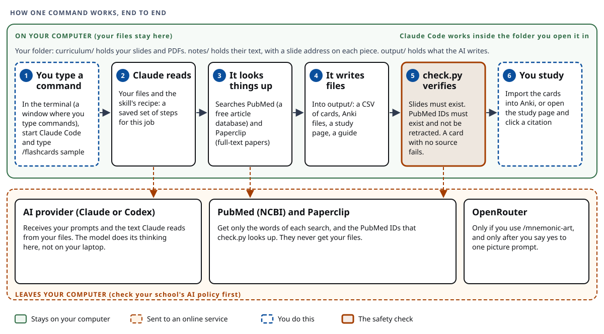
</p>

## Contents

[Set up the sample case](#set-up-the-sample-case) · [`/ingest`](#ingest) · [`/flashcards`](#flashcards) · [`/quiz`](#quiz) · [`/study-guide`](#study-guide) · [`/deepen`](#deepen) · [`/visualize`](#visualize) · [`/mnemonic-art`](#mnemonic-art) · [`/vignette`](#vignette) · [`/teach-back`](#teach-back) · [`/anki-sync`](#anki-sync)

## Things that are true for every skill

- **`<case>` is a folder name.** `/ingest` reads `curriculum/<case>/`. Every other skill reads the notes in `notes/<case>/`. All results go to `output/<case>/`. These three folders are ignored by git, so they never get uploaded by accident.
- **Add a quoted topic to narrow any command**, for example `/flashcards sample "MRSA resistance and treatment"`.
- **Some skills run only when you type their name:** `/visualize`, `/mnemonic-art`, `/vignette`, `/teach-back`, and `/anki-sync`. The assistant will not start them on its own. The other five it may suggest.
- **Citations are checked.** Whenever a skill writes a file with citations, `scripts/check.py` runs on it and the AI fixes the file until it prints `PASS`. `PASS` means the slides and articles exist. It does not mean they support the claim, so open one or two citations yourself.
- **Attempt first.** Answer or recall before you look at an answer. That is where the learning happens. See [Learning science](LEARNING-SCIENCE.md).
- **Timings** below come from a timed rehearsal on a fresh clone (see [DEMO-WALKTHROUGH.md](DEMO-WALKTHROUGH.md)). Where a skill was not timed, this page says so. Your times will vary with your files and the network.
- **If the assistant stops mid-answer**, run the same command again. Toxin chapters in the sample lecture sometimes trip the AI model's safety filter. A file it wrote before the stop still passes `check.py`.

## Set up the sample case

The examples below use a made-up case named `sample`: a fictional case guide PDF (a wrestler with a skin abscess), a short *S. aureus* lecture deck, and a kidney handout. None of it is real course material. Copy it into the folder the skills read from.

macOS or Linux (in the project folder):

```bash
mkdir -p curriculum && cp -R sample/curriculum curriculum/sample
```

Windows (PowerShell):

```powershell
New-Item -ItemType Directory -Force curriculum | Out-Null; Copy-Item -Recurse sample\curriculum curriculum\sample
```

Then start Claude Code in the project folder (`claude`) and type the commands below. For your own course, copy your files into `curriculum/<your-case-name>/` instead, after you confirm your school's AI policy allows it.

---

## ingest

<p align="center">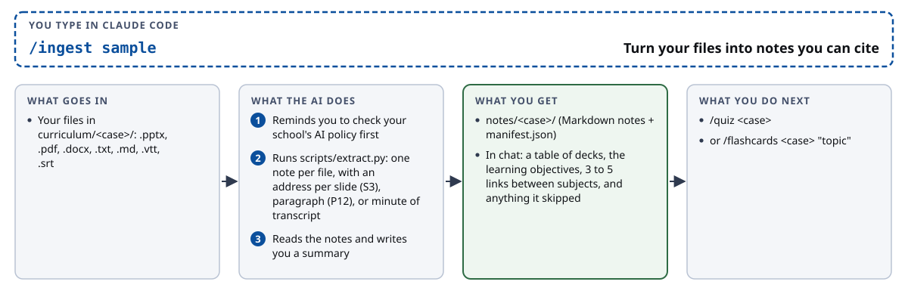</p>

**Use it when:** you start a new case, or add new files to a case folder. Every other skill needs the notes it makes.

**Type:**

```
/ingest sample
```

**What goes in:** the files in `curriculum/sample/`. It reads `.pptx`, `.pdf`, `.docx`, `.txt`, `.md`, and lecture transcripts (`.vtt`, `.srt`). For Keynote or Google Slides, export to PDF or PowerPoint first.

**What you will see:** a table of your decks (for the sample: the case guide with 10 pages, the *S. aureus* deck with 6 slides, and the kidney handout with 4), the learning objectives quoted with their citations, and 3 to 5 links between subjects, such as protein A (microbiology) leading to blocked opsonization (immunology) leading to the abscess (pathology) leading to MRSA resistance (pharmacology). It also lists anything it skipped.

**How long:** about 88 seconds on the sample.

**Where the output goes:** `notes/sample/`, one Markdown note per file plus `manifest.json`. Each slide, paragraph, or minute of transcript gets an address. `[[MICRO/Staphylococcus aureus (sample lecture)#S3]]` is slide 3 of that deck. Nothing else is written.

**Common problems:**

- *A PDF page is flagged "no text on this page, scanned slide".* The AI will not guess what is on it. Retype it or run OCR (text recognition) on the PDF.
- *Videos and old `.ppt` or `.doc` files are skipped.* The summary lists them so you can review them by hand.
- *You did not give a case name.* It lists the folders in `curriculum/` and asks.

**Then:** `/quiz sample` or `/flashcards sample "topic"`.

---

## flashcards

<p align="center">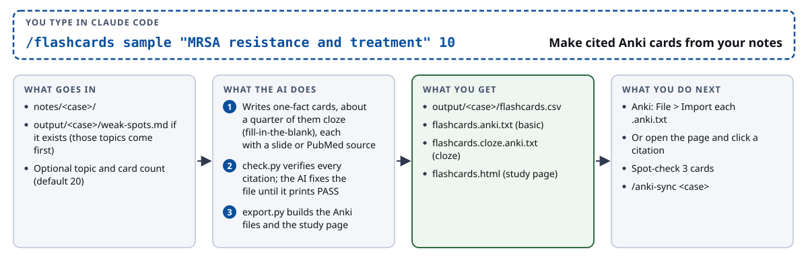</p>

**Use it when:** you want Anki cards for a topic, or fresh cards aimed at the questions you missed.

**Type:**

```
/flashcards sample "MRSA resistance and treatment" 10
```

The topic and the number of cards are both optional. The default is 20 cards. With no topic, it checks which learning objectives still have no card and spends cards there. If `weak-spots.md` exists (from `/quiz`, `/vignette`, `/teach-back`, or `/anki-sync`), those topics come first.

**What goes in:** `notes/sample/`, plus `output/sample/weak-spots.md` if it exists.

**What you will see:** a card count by subject and the two output paths. Cards are one fact each. About a quarter are cloze cards (fill-in-the-blank, such as "Exfoliative toxin cleaves {{c1::desmoglein-1}}"). Up to a fifth may go beyond the slides, using StatPearls or PubMed.

**How long:** 97 to 152 seconds for 14 cards, and about 2.5 minutes for the 10-card MRSA topic. Building the files takes under a second.

**Where the output goes:** in `output/sample/`:

- `flashcards.csv`: the cards, each with its sources
- `flashcards.anki.txt` and `flashcards.cloze.anki.txt`: files you import into Anki (deck `AI Study::sample`)
- `flashcards.html`: a flip-card study page. Click any slide citation to open that slide's text.
- `flashcards_sources/`: the slide text the page opens. It is course material, so keep it to yourself.

Run it again later and it merges new cards into the old file without duplicating a card.

**Common problems:**

- *"notes/sample does not exist."* Run `/ingest sample` first.
- *`check.py` fails.* The AI fixes the file and reruns until it passes. You do not need to do anything.
- *PubMed is down.* Cards cite slides only, and the AI says the literature step was skipped.

**Then:** in Anki choose **File, Import** and pick each `.anki.txt` file once. Or open the page. Spot-check 3 cards against their slide. Then try `/anki-sync sample`.

---

## quiz

<p align="center">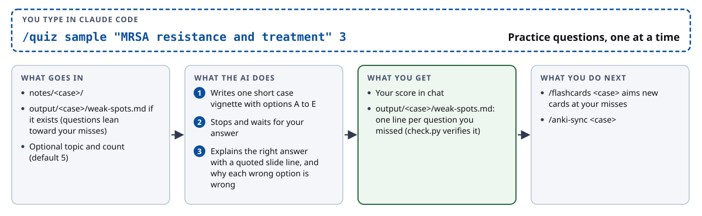</p>

**Use it when:** you want to test yourself before you read anything.

**Type:**

```
/quiz sample "MRSA resistance and treatment" 3
```

**What goes in:** `notes/sample/`, and `weak-spots.md` if it exists (the questions lean toward your earlier misses). The default is 5 questions.

**What you will see:** one short clinical story with options A to E. It waits. You type a letter. Then it explains why the right answer is right, with the supporting slide line quoted and cited, and why each wrong option is wrong. At the end you see your score.

**How long:** the first question appeared in 33 seconds on the sample, and a one-question run with its explanation took under 2 minutes.

**Where the output goes:** each missed topic is added to `output/sample/weak-spots.md` as one line: date, subject, topic, and a slide citation. `check.py` verifies that file.

**Common problems:**

- *The explanations are not run through `check.py`.* Open the quoted slide when you are unsure.
- *The assistant stops partway through a toxin topic.* Run the command again, or pick a different topic.
- *You want harder practice.* Use [`/vignette`](#vignette), which makes you type your own answer before it shows any options.

**Then:** `/flashcards sample` makes cards aimed at your misses. `/anki-sync sample` sends them to Anki.

---

## study-guide

<p align="center">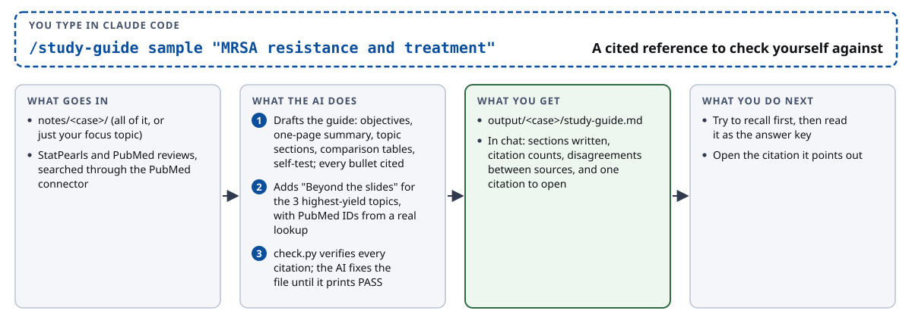</p>

**Use it when:** you have already tried to recall a topic and want an answer key to check yourself against. Do not use it as your first read.

**Type:**

```
/study-guide sample "MRSA resistance and treatment"
```

Leave the topic off to cover the whole case.

**What goes in:** `notes/sample/` (all of it, or the files for your topic), plus StatPearls chapters and recent PubMed reviews, found through the PubMed connector.

**What you will see:** the AI reports the sections it wrote, how many course and PubMed citations the guide has, any **discrepancies** (places where two sources disagree, shown with both sides cited so you can ask faculty), and one citation it suggests you open and compare.

**How long:** 3 to 4 minutes for the whole sample case, and about 4 to 4.5 minutes for the MRSA topic.

**Where the output goes:** `output/sample/study-guide.md`. It has learning objectives, a one-page summary, a section for each topic, comparison tables, a "Beyond the slides" section with PubMed IDs, a Discrepancies section, and a five-question self-test with the answers folded away. Add `--guide output/sample/study-guide.md` when you export cards and the study page gets a Study guide tab.

**Common problems:**

- *PubMed is unavailable.* The "Beyond the slides" section says it was skipped and marks the facts `[source needed]`.
- *`check.py` does not check every line.* It skips plain paragraphs and the self-test answers, so read those yourself.
- *The assistant stops on a toxin topic.* Run it again. One run in three stopped once and then recovered.

**Then:** read it after you try to recall. Open the citation it points out and confirm the source says what the guide claims.

---

## deepen

<p align="center">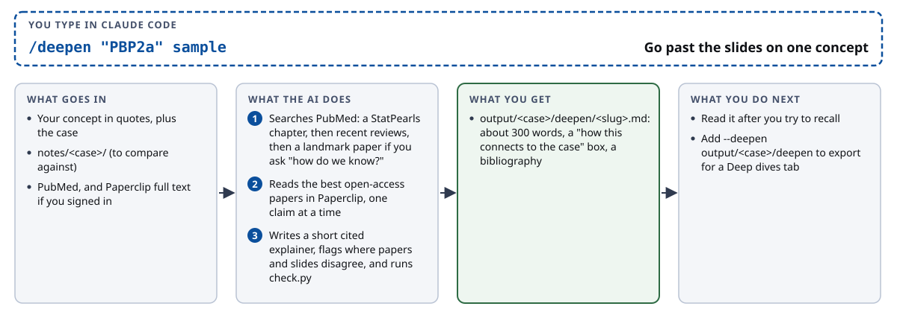</p>

**Use it when:** the slides leave you asking "why?" or "how do we know?" about one concept.

**Type:**

```
/deepen "PBP2a" sample
```

The concept goes in quotes. The case name is optional if you only have one case in `notes/`.

**What goes in:** your concept, `notes/sample/` (to compare against), PubMed, and Paperclip full text if you are signed in.

**What you will see:** a short explainer written from a StatPearls chapter first, then recent reviews, then one landmark paper if you ask how we know. It tells you where a paper and your slide disagree, with both cited.

**How long:** not timed in the rehearsal. Expect a few minutes, because it searches and reads papers.

**Where the output goes:** `output/sample/deepen/<concept>.md`: an explainer of about 300 words, a "how this connects to the case" box, and an annotated bibliography. Export with `--deepen output/sample/deepen` to add a Deep dives tab to the study page.

**Common problems:**

- *Paperclip is not signed in.* It continues with article abstracts and tells you.
- *PubMed is unavailable.* It writes a slides-only explainer and says the literature step was skipped.

**Then:** read it after you try to recall the concept yourself.

---

## visualize

<p align="center">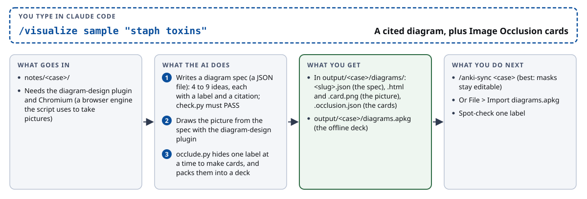</p>

**Use it when:** a topic is easier to remember as a picture, such as how several toxins act on the body. You type this skill's name yourself.

**Type:**

```
/visualize sample "staph toxins"
```

**What goes in:** `notes/sample/`. It needs the **diagram-design plugin** (installed once, with two commands the skill prints for you if it is missing) and **Chromium** (a browser engine the script uses to take pictures; the skill prints a one-line install command if it is missing).

**What you will see:** the AI first writes a **spec**, a JSON file listing 4 to 9 ideas, each with a short label and a citation. `check.py` must pass on the spec. Then it draws the picture from the spec. Then `occlude.py` makes **Image Occlusion** cards: the picture with one label hidden at a time, so you recall each label. It ends with the file paths, the label count, and one label for you to spot-check.

**How long:** not timed in the rehearsal.

**Where the output goes:** `output/sample/diagrams/`: `<topic>.json` (the cited spec), `<topic>.html` and `<topic>.card.png` (the picture), `<topic>.occlusion.json` (the card data). Plus `output/sample/diagrams.apkg`, an offline Anki deck. A finished example is in `examples/diagrams/`. To show diagrams on your study page, export with `--diagrams output/sample/diagrams`.

**Common problems:**

- *The plugin is missing.* The skill prints the two install commands (`/plugin marketplace add cathrynlavery/diagram-design`, then `/plugin install diagram-design@diagram-design`) and stops. In Codex this plugin is not available, so `/visualize` stops there and the other skills still work.
- *Chromium is missing.* Run the install line the script prints, then rerun.

**Then:** `/anki-sync sample` creates Image Occlusion notes in Anki (best, because you can still edit the masks). Or choose **File, Import** with `diagrams.apkg`, which needs no add-on.

---

## mnemonic-art

<p align="center">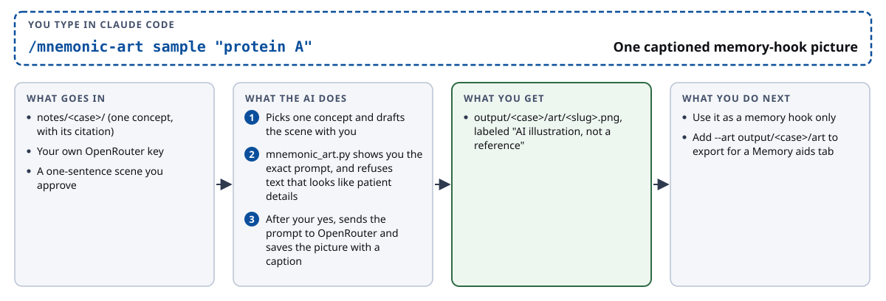</p>

**Use it when:** you want one silly, memorable picture to hold a fact. This is a memory aid, never a source of facts. You type this skill's name yourself.

**Type:**

```
/mnemonic-art sample "protein A"
```

**What goes in:** one concept from the notes with its citation, a one-sentence scene that you and the AI write together (objects and cartoon characters, no patient details), and **your own OpenRouter key**. OpenRouter is a separate paid service that makes the image. Setup is in [`REQUIREMENTS.md`](REQUIREMENTS.md#notes-by-feature).

**What you will see:** the exact prompt on screen, with a notice that it will go to OpenRouter. Nothing is sent until you say yes. The script refuses prompts that look like they contain patient details.

**How long:** not timed in the rehearsal. Each picture costs a small amount of credit.

**Where the output goes:** `output/sample/art/<concept>.png`, labeled "AI illustration, not a reference". Export with `--art output/sample/art` to add a Memory aids tab.

**Common problems:**

- *No key found.* The script prints setup steps and stops.
- *"Refused".* The text looked patient-identifying. Reword the scene.
- *Check your school's AI policy.* This is the only skill that sends text to a second company.

**Then:** use the picture as a hook only. Your citation always points to the notes.

---

## vignette

<p align="center">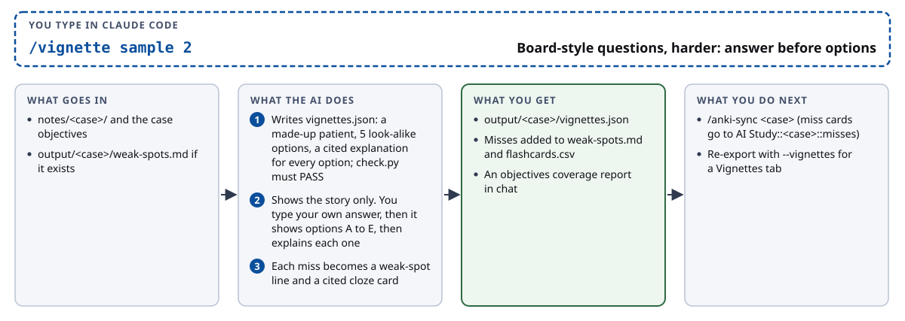</p>

**Use it when:** you want board-style practice that is harder than `/quiz`. You type this skill's name yourself.

**Type:**

```
/vignette sample 2
```

The number is optional. The default is 5.

**What goes in:** `notes/sample/`, the case's learning objectives, and `weak-spots.md` if it exists.

**What you will see:** the AI writes the vignettes first and checks them. Then it shows **only the patient story**, and you type your own answer in your own words. Only then does it show options A to E (five look-alike answers from one category). After you pick, it explains every option and quotes the slide line. Last, it prints an objectives report that shows which learning objectives your cards and vignettes cover.

**How long:** the first question took 87 seconds on the sample (the AI is writing and checking all of them), then 7 to 40 seconds per turn.

**Where the output goes:** `output/sample/vignettes.json`. Each question you missed is added to `weak-spots.md` and becomes a cited cloze card in `flashcards.csv`. Export with `--vignettes output/sample/vignettes.json` to add a Vignettes tab to the study page.

**Common problems:**

- *The explanations are checked for existing sources, not for support.* Open the quoted slide when unsure.
- *You skipped the free-text answer.* Do not. Writing it first is the point.

**Then:** `/anki-sync sample`. Miss cards land in the subdeck `AI Study::sample::misses`.

---

## teach-back

<p align="center">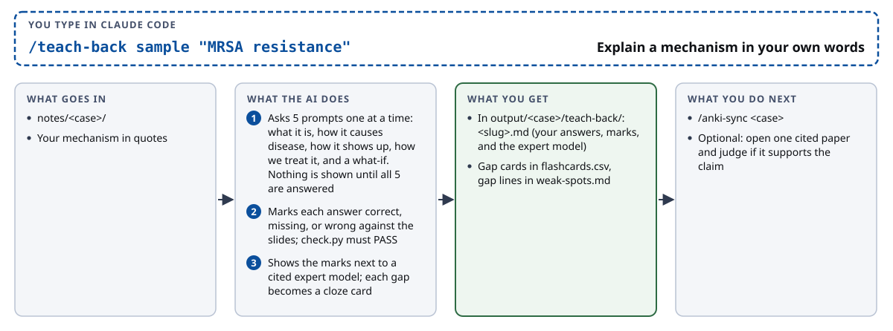</p>

**Use it when:** you think you understand a mechanism and want to find out. You type this skill's name yourself.

**Type:**

```
/teach-back sample "MRSA resistance"
```

**What goes in:** `notes/sample/` and the mechanism you name.

**What you will see:** five prompts, one at a time: what it is, how it causes disease, how it shows up, how we treat it, and a what-if ("what changes if...?"). You answer each in your own words. **Nothing from the notes is shown until all five are answered.** Then each answer is marked `correct`, `missing`, or `wrong` against the slides, and shown next to a cited expert model. You can also ask it to open one cited paper and judge whether it supports the claim.

**How long:** not timed. It is a back-and-forth, so it takes as long as you take to write five answers.

**Where the output goes:** `output/sample/teach-back/<mechanism>.md` holds your answers, the marks, and the expert model. Each gap becomes a cited cloze card in `flashcards.csv` and a line in `weak-spots.md`.

**Common problems:**

- *The assistant stopped on toxin topics in every rehearsal run.* Pick another mechanism, such as drug resistance or kidney clearance.

**Then:** `/anki-sync sample`. Gap cards land in `AI Study::sample::misses`.

---

## anki-sync

<p align="center">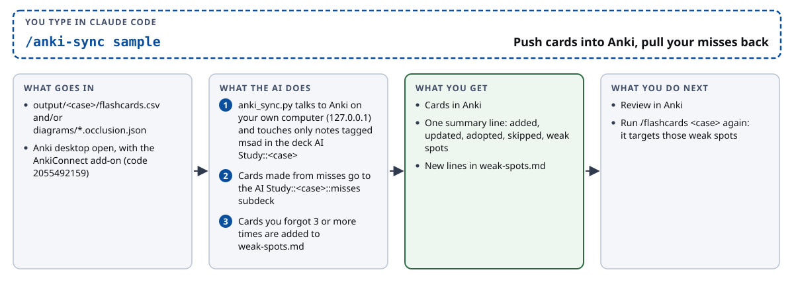</p>

**Use it when:** you have made cards with `/flashcards` or `/visualize` and want them in Anki without importing files by hand, or you have been reviewing in Anki and want your most-missed cards to feed the next round. You type this skill's name yourself.

**Type:**

```
/anki-sync sample
```

**What goes in:** `output/sample/flashcards.csv` and/or `output/sample/diagrams/*.occlusion.json`. **Anki desktop must be open** with the **AnkiConnect** add-on installed (in Anki, Tools, Add-ons, Get Add-ons, code `2055492159`, then restart Anki). AnkiConnect lets a program on your own computer talk to Anki. It never leaves your machine: the script talks only to `127.0.0.1`.

**What you will see:** one summary line, `added N, updated N, adopted N, skipped N, weak spots N`. It touches only notes that carry the tag `msad` and sit in the deck `AI Study::sample`. It never edits your own decks or a premade deck such as AnKing. Cards made from misses go to the subdeck `AI Study::sample::misses`. Cards you forgot three or more times are added to `weak-spots.md`.

**How long:** about 4 seconds for 16 cards.

**Where the output goes:** cards in Anki, and new lines at the end of `output/sample/weak-spots.md`. Nothing syncs in the background: weak spots arrive only when you run the command again.

**Common problems:**

- *"Not reachable" or exit code 2.* Anki is closed or AnkiConnect is missing. Open Anki, install the add-on, and rerun. Or skip the sync and use **File, Import** with the `.anki.txt` files.
- *`skipped` is more than 0.* A note was left alone because it sat outside the owned deck, or the Image Occlusion note type is missing. The skill explains each skip.
- *Running it twice.* It updates cards. It does not duplicate them.

**Then:** review in Anki. After a week, run it again, and `/flashcards sample` will target the cards you keep missing.
