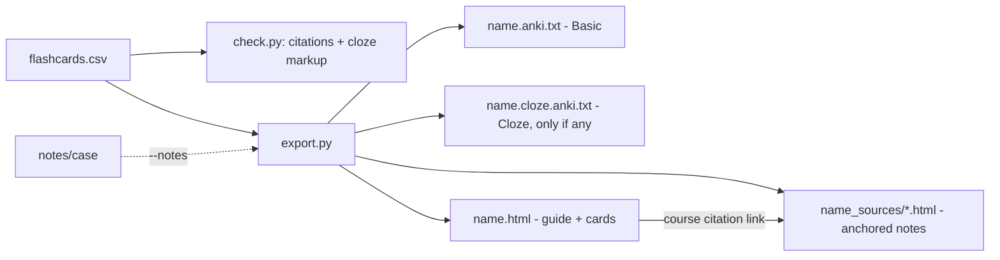

# Cloze Cards and Clickable Source Links - Plan

## Goal Capsule

- **Objective:** An M1/M2 student can study cloze-deletion cards as well as basic cards from their own course, in Anki and in the study page, and can click any slide citation to see the exact slide text that backs a card.
- **Means:** Detect cloze cards by Anki `{{cN::…}}` syntax in the existing CSV (KTD1), export them to a separate Cloze-notetype import file (KTD2), and render cited notes into linkable source pages next to the study page (KTD3).
- **Authority:** Product Contract requirements (R1–R7) > Key Technical Decisions > unit Approach text.
- **Stop conditions:** Stop if any change would require committing files from `curriculum/`, `notes/`, or `output/`, or would break `uv run scripts/*.py` with no install step.
- **Execution profile:** Small, single-repo change across two uv inline scripts (`scripts/check.py`, `scripts/export.py`), five skill files, and docs. Finished and shipped as one PR to `main`.

---

## Product Contract

### Summary

Add cloze-deletion flashcards end to end (skill, CSV contract, checker, Anki export, study page), and make course citations in the study page open a rendered copy of the cited slide. Then reconcile every documented command and contract with the scripts.

### Problem Frame

The doc review of 2026-11-03 left three items open. Students who live in Anki expect cloze cards, and the deck only produced front/back cards. Course citations in the study page were plain labels, so checking a card against its slide meant hunting through `notes/` by hand, which works against the spot-check habit the README now asks for. The skills and README were also rewritten that day, so the commands they document need one more pass against the scripts.

### Requirements

- **R1.** A flashcard row whose `front` contains Anki cloze markup (`{{c1::answer}}` or `{{c1::answer::hint}}`) is a cloze card. Every other row is a basic card. The CSV columns stay `front,back,sources,tags`.
- **R2.** `scripts/check.py` fails a deck with malformed cloze markup (an unclosed `{{c`, a missing number, an empty deletion) and still requires a citation on every cloze card. A cloze card's `back` may be empty.
- **R3.** `scripts/export.py` writes cloze cards to an Anki import file that uses the Cloze note type, writes basic cards to the existing Basic import file, and keeps stable per-card IDs so re-importing updates cards.
- **R4.** The HTML study page shows a cloze card with each deletion hidden (showing its hint when one exists) and reveals the deletions on flip.
- **R5.** When `export.py` is given the notes folder, every course citation in the study page is a link that opens a rendered copy of the cited notes file scrolled to the cited slide, paragraph, or table. The visible label stays "deck · S#".
- **R6.** Without the notes folder, the study page renders course citations as plain labels exactly as today.
- **R7.** Every command, flag, file name, and column the README, `CLAUDE.md`, the five skills, and `docs/OPEN-RESOURCES.md` document matches what the scripts accept and produce.

### Key Decisions

- **No school course files in the public repo.** `curriculum/`, `notes/`, `output/`, and `DEMO.md` stay gitignored, and `sample/` and `examples/` stay synthetic. Governs R5, R7. (session-settled: user-directed — chosen over a private repo including one school case: course material belongs to the school)
- **Citation syntax is unchanged:** `[[path#S#|P#|T#]]` and `[PMID:n]`. Governs R2, R5. (session-settled: user-approved — chosen over footnote or BibTeX citations: one greppable format shared by guides, cards, and checker)

### Scope Boundaries

- Image occlusion cards, `.apkg` packaging, and AnkiConnect sync are out of scope.
- The notes-file rendering is for reading slide text. It does not reproduce slide images.

### Assumptions

- Students import with Anki 2.1.55 or later, which reads the `#notetype:` and `#guid column:` file headers.
- The slides used in the demo contain no patient information, and the instructor has confirmed that sending them to the AI API is acceptable. `DEMO.md` (local only) states this in the hook.

---

## Planning Contract

### Key Technical Decisions

- **KTD1. Cloze is detected by markup, not by a new column.** A row is cloze when `front` contains `{{c<digits>::`. This keeps old decks and the four-column contract valid, and it matches what students already type in Anki.
- **KTD2. Cloze cards export to a sibling file `<name>.cloze.anki.txt` with `#notetype:Cloze`.** It is written only when the deck has cloze cards. The Cloze note type's fields are Text and Back Extra, so `front` maps to Text and `back` plus the source line maps to Back Extra. The Basic file gains an explicit `#notetype:Basic` header. One file per note type is the import shape Anki handles without field-mapping prompts.
- **KTD3. Source links point at rendered HTML copies of the cited notes files, written to `<name>_sources/` next to the study page.** Browsers do not scroll to an anchor inside a raw `.md` file, so each cited notes file is rendered once with anchors. The anchor contract:
  - Every `[S#]`, `[P#]`, or `[T#]` marker that starts a heading (`## [S3] …`) or a line (`[P12] …`) becomes an element with `id` equal to the marker (`S3`, `P12`, `T2`).
  - Each bare `[P#]` line becomes its own paragraph, so consecutive lines never merge.
  - Hrefs percent-encode each path segment, because real deck names contain spaces and parentheses.
  - A cited path must resolve inside `--notes` and its output inside `<name>_sources/`. Anything else (`../`, missing file, marker not at a heading or line start) stays a plain label and prints a warning.

  Links appear only in the HTML study page. The Anki files keep plain labels, because Anki cannot reach files next to the page. Each source page carries a visible "Course material from your school — for your own study, do not share" banner, and the export prints the same reminder. Only cited files are rendered. For real course decks the output stays under the gitignored `output/`.
- **KTD5. The study page shows one card per cloze note with all deletions hidden.** Anki makes one card per `cN` number. The page is a quick-review view, so it reveals every deletion on flip, and the README says Anki is the place for spaced review.
- **KTD4. Scripts stay uv inline scripts, and tests run through uv with pytest supplied on the fly.** Tests live in `tests/` and load scripts by file path, so no packaging is introduced. (session-settled: user-approved — chosen over a packaged Python project: zero-setup for students)

### High-Level Technical Design

---

## Implementation Units

### U1. Cloze validation in the checker

**Goal:** `check.py` recognizes cloze cards and rejects malformed cloze markup.
**Requirements:** R1, R2
**Dependencies:** none
**Files:** `scripts/check.py`, `tests/test_check.py`, `tests/conftest.py`
**Approach:**
1. Add a cloze detector and a well-formedness check over the `front` field, per KTD1.
2. Report malformed markup as a per-card problem, alongside the existing citation checks. The no-citation rule applies to cloze cards unchanged.
3. Update the module docstring's "What it checks" list.
**Patterns to follow:** the existing `MALFORMED` per-card problem reporting in `load_units`.
**Test scenarios:**
- A deck with one valid `{{c1::Desmoglein-1}}` card with a course citation passes.
- A card with `{{c1::answer::hint}}` passes.
- A card with two deletions `{{c1::a}}` and `{{c2::b}}` passes.
- A card with an unclosed `{{c1::answer` fails, naming the card.
- A card with `{{c::answer}}` (no number) fails.
- A card with `{{c1::}}` (empty deletion) fails.
- A valid cloze card with no citation fails with "no citation".
- A basic card with an empty `back` is not flagged by the cloze checks (behavior unchanged from today).
- The existing `examples/hallucination-test.csv` still reports exactly its three problems.
**Verification:** the new tests pass, and the existing example deck still passes.

### U2. Cloze export, cloze viewer, and source-link pages

**Goal:** `export.py` writes the Cloze import file, renders cloze cards in the study page, and links course citations to rendered source pages.
**Requirements:** R3, R4, R5, R6
**Dependencies:** U1
**Files:** `scripts/export.py`, `tests/test_export.py`
**Approach:**
1. Split cards into basic and cloze by the KTD1 detector, and write the two Anki files per KTD2. Reuse the existing stable-ID scheme for both.
2. Add an optional `--notes` argument. When it is given, render each cited notes file to `<name>_sources/<path>.html` per KTD3, and make course citations in the study page relative links to `…html#S3`. Do this for citations in the guide and in the cards alike. Without it, keep today's plain label (R6). Parameterize the existing `linkify` rather than duplicating it, and keep the Anki output on the plain-label path.
3. In the HTML template, render cloze fronts with each deletion replaced by `[…]` or `[hint]`, and reveal the highlighted deletions on flip, per KTD5.
4. Before writing either Anki file, detect two cards whose fronts produce the same stable ID, and warn, naming both.
**Patterns to follow:** the existing `linkify` and Anki-header code in `scripts/export.py`.
**Test scenarios:**
- A mixed deck writes both `.anki.txt` (`#notetype:Basic`) and `.cloze.anki.txt` (`#notetype:Cloze`), each containing only its own cards.
- A basic-only deck writes no `.cloze.anki.txt`, and removes a stale one left by an earlier run.
- Cloze rows keep the `{{c1::…}}` markup intact in the Anki file (not HTML-escaped into a different form).
- The stable ID for the same `front` is identical across two runs.
- With `--notes`, a citation `[[MICRO/X#S3]]` becomes a link whose target file exists under `<name>_sources/` and contains `id="S3"`.
- With `--notes`, citations to `#S3` (heading), `#P12` (bare paragraph line), and `#T1` (table heading) each link to an element with that id, and that element contains the expected synthetic text.
- Two consecutive bare `[P#]` lines render as two elements with two ids.
- A citation to the sample's `Staphylococcus aureus (sample lecture)` deck produces a percent-encoded href that resolves to an existing file.
- With `--notes`, a citation to a missing notes file, a `../` path, or a marker that is not at a heading or line start stays a plain label and prints a warning, without crashing or writing outside `<name>_sources/`.
- A course citation inside the `--guide` Markdown also becomes a link.
- The `.anki.txt` and `.cloze.anki.txt` files contain no `_sources/` hrefs, even with `--notes`.
- Each rendered source page contains the do-not-share banner.
- Two cards with the same front produce a duplicate-ID warning.
- Without `--notes`, no `_sources/` folder is created and citations are plain labels.
- The study-page card data marks cloze cards so the viewer hides their deletions.
**Verification:** the tests pass, the example export opens in a browser, cloze cards hide and reveal, and a citation link lands on the cited slide.

### U3. Reconcile skills and docs with the scripts

**Goal:** Every documented command and contract matches the scripts after U1 and U2.
**Requirements:** R7
**Dependencies:** U1, U2
**Files:** `.claude/skills/flashcards/SKILL.md`, `.claude/skills/study-guide/SKILL.md`, `.claude/skills/deepen/SKILL.md`, `.claude/skills/ingest/SKILL.md`, `.claude/skills/quiz/SKILL.md`, `CLAUDE.md`, `README.md`, `docs/OPEN-RESOURCES.md`, `DEMO.md` (local, gitignored)
**Approach:**
1. In the flashcards skill, allow cloze cards in the mix, show the markup, and pass `--notes notes/<case>` to the export.
2. In the README and `CLAUDE.md`, document cloze markup, the second Anki file, the `--notes` source links, and the test command.
3. Add a README line that course slides normally contain no patient data and that patient information (PHI) never goes into these tools.
4. In `DEMO.md`, fill the hook placeholder with the instructor's confirmation that the slides contain no patient information and are OK to send to the API. Show both Anki imports and a source-link click in Act 4.
5. Walk each documented command in all five skills, the README, and `CLAUDE.md` against the scripts' argument parsers and output names, and fix any drift found.
**Test expectation:** none -- documentation only. Verified by the command walk in step 5.
**Verification:** every script invocation in the docs and skills runs as written against `sample/`.

### U4. Regenerate the synthetic examples

**Goal:** `examples/` demonstrates cloze cards and source links from the synthetic sample only.
**Requirements:** R1, R3, R4, R5
**Dependencies:** U1, U2
**Files:** `examples/flashcards.csv`, `examples/flashcards.anki.txt`, `examples/flashcards.cloze.anki.txt`, `examples/flashcards.html`, `examples/flashcards_sources/`
**Approach:**
1. Add 2–3 cloze cards to the sample deck, cited to the synthetic lecture.
2. Re-export with `--notes sample/notes`.
3. Run the checker on the guide, the deck, and the hallucination test.
**Test expectation:** none -- generated artifacts. Covered by U1/U2 tests and the check runs.
**Verification:** both example checks PASS, the hallucination test FAILs with its three problems, and `git status` shows no files from `curriculum/`, `notes/`, or `output/`.

---

## Verification Contract

- Run the tests with uv supplying pytest: `uv run --with pytest --with python-pptx --with python-docx --with markdown pytest tests -q`.
- Run `uv run scripts/check.py` on `examples/study-guide.md` and `examples/flashcards.csv` with `--notes sample/notes`: both PASS.
- Run `uv run scripts/check.py examples/hallucination-test.csv --notes sample/notes`: exit 1 with exactly three problems.
- Manual check before the demo: import `examples/flashcards.anki.txt` and `examples/flashcards.cloze.anki.txt` into desktop Anki. Confirm the Basic and Cloze note types, the card counts, and that a second import updates rather than duplicates. Until that passes, the previous example files stay recoverable from git.
- The staged diff contains nothing under `curriculum/`, `notes/`, or `output/`, and does not contain `DEMO.md`.

## Definition of Done

- R1–R7 hold, and the U1 and U2 tests pass.
- The examples are regenerated, and the three check runs give the expected results.
- The docs and skills match the scripts (U3 step 5).
- No abandoned or experimental code is left in the diff.
- The work ships as one PR to `main`.
