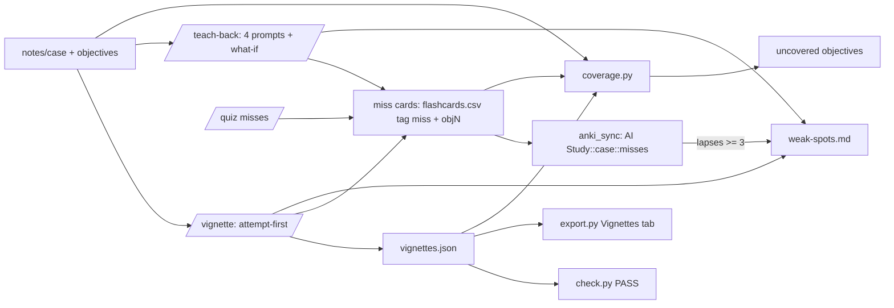

# Evidence-Based Active-Learning Practice - Plan

## Goal Capsule

- **Objective:** An M1/M2 student can practice a case with attempt-first board-style vignettes and mechanism teach-back, have every miss become a cited cloze card that lands in Anki under `AI Study::<case>::misses`, see which learning objectives still have no card or vignette, and read what evidence backs each skill.
- **Means:** A cited vignette format validated by `scripts/check.py` (KTD1), a Vignettes study-page tab that hides options until the student types an answer (KTD2), `/vignette` and `/teach-back` skills (KTD3, KTD4), `miss`-tagged cards routed by `scripts/anki_sync.py` (KTD5), a standalone `scripts/coverage.py` objectives report (KTD6), and `docs/LEARNING-SCIENCE.md` (KTD7).
- **Authority:** Product Contract requirements (R1-R12) > Key Technical Decisions > unit Approach text.
- **Stop conditions:**
  - Stop if a unit would commit or read course files (`curriculum/`, `notes/`, `output/`, `DEMO.md`).
  - Stop if a unit would let the AI reveal vignette options or an expert model before the student's own attempt.
  - Stop if a unit would write PMIDs outside the 16 listed in R11, or touch notes outside `msad`-tagged notes in `AI Study::<case>` decks.
- **Execution profile:** One repo, standalone uv scripts, two new skills, edits to four existing skills, one doc. Built on `feat/evidence-based-practice`, stacked on `feat/visual-learning-anki-sync` (PR #2 still open).

---

## Product Contract

### Summary

Add the three highest-yield practice features chosen from a learning-science audit, plus the reference doc:
- `/vignette` generates about 5 synthetic board-style vignettes per case, attempt-first, with look-alike distractors and a cited explanation for every option.
- `/teach-back` has the student explain one mechanism chain in their own words, marks each step against the slides, then shows a cited expert model.
- The miss-to-card-to-review loop turns misses from `/vignette`, `/teach-back` and `/quiz` into cloze cards that `/anki-sync` pushes into a `::misses` subdeck, and reports objectives that have no card or vignette.
- `docs/LEARNING-SCIENCE.md` maps each skill to its evidence and states the limits of that evidence.

### Problem Frame

The repo has recall cards and a one-way quiz, but nothing makes the student produce an answer before seeing content, nothing separates look-alike diagnoses, and a quiz miss only becomes a weak-spot line, not a card. Evidence on AI tutors without guardrails (PMC12232635) says showing answers first can harm later unaided performance, so every new skill is attempt-first.

### Requirements

- **R1.** `/vignette <case>` writes `output/<case>/vignettes.json` with about 5 synthetic vignettes aimed at the case's learning objectives; each has exactly 5 options, exactly one correct.
- **R2.** Distractors are confusable look-alike diagnoses from the same category as the answer (interleaving of similar categories).
- **R3.** Every option carries an explanation of why it is right or wrong, each with at least one `[[path#S#]]` citation (optional `[PMID:n]` only from a PubMed tool call this session).
- **R4.** `scripts/check.py` validates a vignette file: 5 options, keys A-E, one correct, every explanation cited, every citation and anchor resolves, no patient-identifier shapes in stem or options, unique ids, valid optional objective number. A malformed file fails with a readable message.
- **R5.** The flow is attempt-first: the student writes a free-text answer before options are shown, then picks one. Misses append to `output/<case>/weak-spots.md`.
- **R6.** The study page gains a Vignettes tab (`export.py --vignettes`) that keeps options hidden until the student has typed an answer.
- **R7.** `/teach-back <case> "<mechanism>"` asks four prompts in order (what it is, how it causes disease, how it shows up, how we treat it) plus one "what if" prompt, collecting each answer before showing anything. It marks each step correct, missing or wrong with a slide citation, then shows a cited expert model. Gaps become cloze cards in the case CSV and weak spots.
- **R8.** Teach-back offers one optional step: open one cited PMID and judge whether it supports the claim.
- **R9.** Cards from misses carry the tag `miss`; `anki_sync.py` places them in `AI Study::<case>::misses`, only for `msad`-tagged notes, idempotent on re-sync; lapses on those cards feed `weak-spots.md` through the existing path.
- **R10.** `scripts/coverage.py` lists each case learning objective with no tagged card and no vignette covering it.
- **R11.** `docs/LEARNING-SCIENCE.md` has an evidence table mapping each skill to its evidence, using only these PMIDs: 19930508, 23746156, 27295475, 25920573, 16719566, 26498443, 42183420, 26173288, 25626750, 15612907, 27246965, 23969375, 31556629, 27072443, 20374475, 23020639; plus Bastani et al. PNAS 2025 cited by PMCID PMC12232635 only. It states that Anki evidence is observational and AI-harm evidence is mixed, and `scripts/check.py` passes on it. Each new skill's `reference.md` links it.
- **R12.** `/mnemonic-art`'s description gains the note "low evidence: memory aid only".

### Key Decisions

- **Build exactly these three plus the doc.** Governs R1-R12. (session-settled: user-directed; chosen over standalone /compare, /connect, /what-if, /whiteboard photo grading, /spaced-plan: chosen after a learning-science audit)
- **Attempt-first in every new skill.** Governs R5, R6, R7. (session-settled: user-approved; chosen over show-then-quiz: unguarded AI tutor harmed later unaided performance)
- **Citation syntax unchanged; check.py validates every artifact; PMIDs only from tool calls this session.** Governs R3, R4, R11. (session-settled: user-approved; chosen over new citation formats: hallucination control)
- **No course files in the repo; scripts stay standalone uv inline scripts, small regex duplication is deliberate.** Governs R4, R6, R9, R10. (session-settled: user-directed; chosen over a shared package: students run single scripts)
- **Skills follow writing-for-agents: SKILL.md at most about 40 lines, front-loaded trigger, "Done when" per step, detail in reference.md, hand-run skills set `disable-model-invocation: true`.** Governs R1, R7. (session-settled: user-directed; chosen over long monolithic skills)
- **Anki sync owns only `msad`-tagged notes in `AI Study::<case>` decks; synthetic patients only; study aid only.** Governs R9. (session-settled: user-directed; chosen over broader deck ownership)

### Scope Boundaries

- No standalone `/compare`, `/connect`, `/what-if`, `/whiteboard`, `/spaced-plan`.
- No AI-generated grading of graded work; no real patient data.
- No automatic PubMed searching inside scripts; PMIDs come from the agent's tool calls and are verified by `check.py`.
- Tagging existing cards with objectives is the student's or skill's job going forward; no retroactive classification of old cards.

### Assumptions

- Objectives are parsed from the notes line `Learning objectives: (1) ...; (2) ...` (as in `sample/`). A case whose notes have no such line makes `coverage.py` report "no objectives found" and exit 0.
- Objective coverage is explicit, not inferred: a card covers objective N when its tags include `objN`; a vignette covers it through its `objective` field. This is deterministic and testable; semantic matching is out of scope.
- Teach-back and quiz misses are written by the agent into `flashcards.csv` (merge, dedupe by `front`) with tags `...;miss;objN`, so no new file format is needed.

---

## Planning Contract

### Key Technical Decisions

- **KTD1. Vignette file format and validation (in `check.py`).** `output/<case>/vignettes.json` is `{"vignettes": [{"id", "objective"?, "discipline"?, "stem", "options": [{"key", "text", "correct", "explanation"}]}]}`. A `.json` whose top level has a `vignettes` key takes the vignette branch; any other `.json` stays a diagram spec. Checks: ids match `^[a-z0-9-]{1,40}$` and are unique; stem non-empty; exactly 5 options with keys A-E once each; exactly one `correct: true`; every `explanation` non-empty and carrying a citation, resolved by the existing `anchor_exists` and PMID verification; `objective`, when present, is an integer 1 or more. A PHI-shape screen runs over stem, option text and explanation using a copy of `PHI_PATTERNS` from `scripts/mnemonic_art.py` (duplication is deliberate). Output prints "N vignettes". A PASS proves sources exist, not that they support the explanation.
- **KTD2. Vignettes tab keeps options hidden until an attempt exists.** `export.py --vignettes <vignettes.json>` adds a tab (same mechanism as Diagrams/Memory aids). Server-side HTML emits the stem and a textarea only; option markup lives in a `<template>` or inert container with the `hidden` attribute and is not in the visible DOM. A "Show options" button stays disabled until the textarea has non-whitespace text. Choosing an option reveals every option's explanation, with citations linked like card citations, and marks right/wrong. Score and typed text stay in the page only (no storage, no network). Text from the JSON is HTML-escaped. Without the flag the page is unchanged.
- **KTD3. `/vignette` skill.** Steps: read notes and the case objectives and `weak-spots.md`; write vignettes (synthetic patients, look-alike distractors from one category, explanation per option with citation); run `check.py` to PASS; then run the session attempt-first, one vignette at a time: show the stem only, wait for the free-text answer, then show options, wait for the pick, then explanation. Misses append to `weak-spots.md` as `- YYYY-MM-DD | discipline | topic | [[path#S#]]`, then each miss becomes a cloze card per KTD5. Hand-fired.
- **KTD4. `/teach-back` skill.** Steps: pick one mechanism chain from the notes and name its slides; ask the four prompts one at a time, then the "what if" prompt, withholding all content until the student has answered all five; write `output/<case>/teach-back/<slug>.md` with marks as table rows `| step | correct/missing/wrong | [[cite]] |` and the expert model as cited bullets (student text in blockquotes, so `check.py` treats the record as a guide); then show the expert model, then turn each gap into a cited cloze card and weak-spot line. Optional final step: open one cited PMID with the PubMed tool, and judge whether it supports the claim, stating that existence is not support. Hand-fired.
- **KTD5. Miss cards are `miss`-tagged rows routed by `anki_sync.py`.** In `csv_notes`, a row whose tags include `miss` gets `deck = AI Study::<case>::misses`; other rows use `AI Study::<case>`. The client generalizes ownership from "deck equals base" to "deck name is in the owned set {base, base::misses}". Upsert still searches `deck:"AI Study::<case>" tag:msad-id::<id>` (this search includes subdecks), `owned()` requires every card of the note to sit in the owned set, and `addNote` uses the note's own deck. The misses deck is created only when a miss note exists. An existing note is updated in place and never moved. Lapse reading accepts both owned decks, so misses feed `weak-spots.md` through `append_weak_spots` unchanged. `guid(front)` is unchanged, so re-sync is idempotent. The allowlist of AnkiConnect actions is unchanged.
- **KTD6. Objectives coverage is a separate script.** `scripts/coverage.py --notes notes/<case> [--csv ...] [--vignettes ...]` prints each objective as covered (naming how) or uncovered, exits 0 always (a report, not a gate), and prints "all objectives covered" when none are open. Kept out of `check.py` so the vignette unit and the coverage unit touch disjoint files. Objectives parse from any `Learning objectives:` line in the notes folder.
- **KTD7. Evidence doc is checkable.** `docs/LEARNING-SCIENCE.md` is a Markdown guide where every table row ends in a `[PMID:n]` citation so `check.py` verifies each PMID (existence and not retracted, printing titles). Bastani et al. appears in prose by PMCID with no bracket citation (check.py has no PMC form). A short "Limits of this evidence" section states Anki studies are observational and AI-harm results are mixed. Each new skill's `reference.md` links `../../../docs/LEARNING-SCIENCE.md`.

### High-Level Technical Design

### Risks & Dependencies

- **Interpreted coverage is only as good as tagging.** Mitigated by making the skills write `objN` tags and `objective` fields, and by the report naming uncovered objectives plainly.
- **Deck-search semantics.** Anki's `deck:"X"` includes subdecks, so existing lookups find misses notes; the tests pin that an unrelated deck such as `AI Study::<case>::diagrams-offline` is still never edited.
- **Typed answer is not graded in the page.** The page only gates options on non-empty input; honest attempts rely on the student. Documented in `reference.md`.
- **PubMed access for `check.py` on the doc and example.** Tests that need PubMed must not hit the network; verification of the doc runs as an explicit command.

---

## Implementation Units

Units U1-U6 touch disjoint files and can run in parallel. U7 runs last.

### U1. Vignette validation in check.py, with example

**Goal:** `check.py` validates vignette files; a synthetic example exists.
**Requirements:** R1, R3, R4
**Dependencies:** none
**Files:** `scripts/check.py`, `tests/test_check.py`, `examples/vignettes.json`
**Approach:**
1. Test first: add tests (observe failures), then add the vignette branch per KTD1, including a local copy of the PHI patterns.
2. Write `examples/vignettes.json`: 5 synthetic vignettes from `sample/` slides S2-S6, `objective` set to 1, 2 or 3 so all three objectives are covered, each with look-alike distractors, citing `[[MICRO/Staphylococcus aureus (sample lecture)#S#]]` on every explanation.
**Patterns to follow:** `spec_units` structure and `check_id` in `scripts/check.py`; `phi_hit` in `scripts/mnemonic_art.py`.
**Test scenarios:**
- A valid vignette file passes (offline, no PMIDs).
- Four options, six options, duplicate keys, zero or two correct options each fail naming the vignette.
- An option with empty or uncited explanation fails; an explanation citing a missing anchor fails.
- A stem containing an MRN-like number, a date, or a name with an age fails.
- `objective: 0` or `"two"` fails; missing `vignettes` key stays a diagram-spec failure; a non-JSON file fails readably.
- Existing diagram spec, deck, and guide checks are unchanged.
**Verification:** `uv run scripts/check.py examples/vignettes.json --notes sample/notes` prints PASS; full test suite green.

### U2. Objectives coverage script

**Goal:** A standalone report of uncovered learning objectives.
**Requirements:** R10
**Dependencies:** none
**Files:** `scripts/coverage.py`, `tests/test_coverage.py`
**Approach:** Test first. Parse `Learning objectives:` lines from the notes folder into numbered objectives; read card tags `objN` from a CSV and `objective` from a vignettes JSON; print covered/uncovered per objective and the uncovered count.
**Patterns to follow:** inline script header and `argparse` style in `scripts/anki_sync.py`.
**Test scenarios:**
- Objectives 1-3 parsed from a fixture notes folder; a card tagged `obj2` and a vignette with `objective: 3` leave only objective 1 reported uncovered.
- All covered prints the "all objectives covered" line.
- No objectives line prints "no objectives found" and exits 0.
- A card tag `obj12` does not count for objective 1; a missing CSV or JSON argument is optional, a nonexistent path is an argument error.
**Verification:** tests green; running against `sample/notes` with `examples/` files lists exactly the gaps.

### U3. Misses routing in anki_sync

**Goal:** `miss`-tagged rows sync into `AI Study::<case>::misses`, owned and idempotent.
**Requirements:** R9
**Dependencies:** none
**Files:** `scripts/anki_sync.py`, `tests/test_anki_sync.py`
**Approach:** Test first with the existing fake AnkiConnect server in the tests, then implement KTD5.
**Patterns to follow:** `Sync.upsert`, `owned`, `lapsed` in `scripts/anki_sync.py`.
**Test scenarios:**
- A `miss` row is added to `AI Study::<case>::misses` with tags `msad` and `msad-id::`; a normal row goes to the base deck.
- Re-syncing the same CSV adds nothing and reports updated counts only.
- A note whose card sits in an unrelated deck (including `::diagrams-offline`) is skipped, not edited.
- A lapsed card in the misses deck appears in weak spots once, via the existing sidecar.
- The misses deck is not created when no miss rows exist; an action off the allowlist still raises.
**Verification:** tests green; sync summary line format unchanged.

### U4. Vignettes tab in export.py

**Goal:** `--vignettes` adds a tab that hides options until the student types an answer.
**Requirements:** R6
**Dependencies:** none (format fixed by KTD1)
**Files:** `scripts/export.py`, `tests/test_export.py`
**Approach:** Test first. Add `vignettes_section` per KTD2 and the `--vignettes` flag, using the extra-tab mechanism. Option markup is kept in an inert `<template>`; escape all JSON text; linkify citations as cards do. Tests build their own small vignette JSON in `tmp_path`.
**Patterns to follow:** `diagrams_section`, `art_section`, and the `extras` list in `scripts/export.py`.
**Test scenarios:**
- Page HTML with `--vignettes` has a Vignettes tab; without it the page is byte-identical to before.
- The initial HTML outside `<template>` contains no option text for any vignette.
- Script-bearing text in a stem or option is escaped.
- A malformed vignettes file fails with a readable error, not a traceback.
- (Playwright, skipped when Chromium is missing) the "Show options" button is disabled until text is typed, options appear after, and picking one reveals explanations with the correct option marked.
**Verification:** tests green.

### U5. Vignette and teach-back skills

**Goal:** The two new skills in writing-for-agents style.
**Requirements:** R1, R2, R3, R5, R7, R8
**Dependencies:** none
**Files:** `.claude/skills/vignette/SKILL.md`, `.claude/skills/vignette/reference.md`, `.claude/skills/teach-back/SKILL.md`, `.claude/skills/teach-back/reference.md`
**Approach:** Per KTD3 and KTD4. Each `SKILL.md` has `disable-model-invocation: true`, a front-loaded description, at most about 40 lines, a "Done when" per step, and one anchoring word (*attempt* for both). Each `reference.md` holds the JSON schema or record template, distractor-design guidance, miss-card recipe (cloze front, `miss;objN` tags, merge rule, `check.py` command), and a link to `../../../docs/LEARNING-SCIENCE.md`.
**Test expectation:** none -- skill prose. Verified by line count and a grep that every step has "Done when".
**Verification:** `wc -l` of each SKILL.md at most 45; front matter parses.

### U6. Learning-science doc

**Goal:** The evidence table and its limits.
**Requirements:** R11
**Dependencies:** none
**Files:** `docs/LEARNING-SCIENCE.md`
**Approach:** Per KTD7: table of skill, mechanism, evidence with `[PMID:n]` per row (every row cites one or more of the 16 listed PMIDs, nothing else), a prose paragraph on Bastani et al. (PMC12232635), a "Limits of this evidence" section. Cover `/vignette`, `/teach-back`, the miss loop, `/flashcards`, `/quiz`, `/visualize`, `/mnemonic-art` (low evidence: memory aid only).
**Test expectation:** none -- doc. Verified with `uv run scripts/check.py docs/LEARNING-SCIENCE.md --notes sample/notes` (needs network) and by checking that every PMID in the file is in the allowed list.
**Verification:** check.py prints PASS and titles that match the table's claims.

### U7. Wiring, existing skills, examples and docs (last)

**Goal:** Connect the pieces and refresh examples.
**Requirements:** R5, R7, R9, R10, R12
**Dependencies:** U1-U6
**Files:** `.claude/skills/quiz/SKILL.md`, `.claude/skills/anki-sync/SKILL.md`, `.claude/skills/anki-sync/reference.md`, `.claude/skills/flashcards/SKILL.md`, `.claude/skills/mnemonic-art/SKILL.md`, `CLAUDE.md`, `README.md`, `examples/flashcards.csv`, `examples/flashcards.html` (and the example `.anki.txt` files it regenerates)
**Approach:**
1. `quiz`: offer miss cards for missed items (same recipe as `/vignette`); `anki-sync`: describe the `::misses` subdeck and that `miss` cards sync there; `flashcards`: mention the `miss` and `objN` tags and `--vignettes`; `mnemonic-art` description: add "low evidence: memory aid only"; `CLAUDE.md` and `README.md`: list the new skills, scripts, and the coverage command.
2. Tag the example cards with `obj1`-`obj3` as fits, add two `miss`-tagged cloze rows, and regenerate `examples/flashcards.html` with `--vignettes examples/vignettes.json --notes sample/notes`.
3. Headless-browser-test the regenerated page's Vignettes tab.
**Test expectation:** none for prose; the script tests and example checks are the verification.
**Verification:** full suite green; `check.py` passes `examples/flashcards.csv`, `examples/study-guide.md`, `examples/vignettes.json`, `examples/diagrams/staph-toxins.json` and fails `examples/hallucination-test.csv` with 3 problems; `coverage.py` on the examples lists the expected gaps.

---

## System-Wide Impact

- `check.py` JSON handling gains a dispatch on the `vignettes` key; diagram specs are unaffected.
- `anki_sync.py` ownership widens from one deck to two named decks under the same case; nothing outside `AI Study::<case>` and `AI Study::<case>::misses` is ever edited.
- The study page gains an optional tab only; absent the flag it is unchanged.

## Deferred Questions

- Whether `coverage.py` should later infer coverage semantically (out of scope, deterministic tagging chosen).
- Whether `/quiz` should itself write `objN` tags (U7 adds the instruction; no script change).
